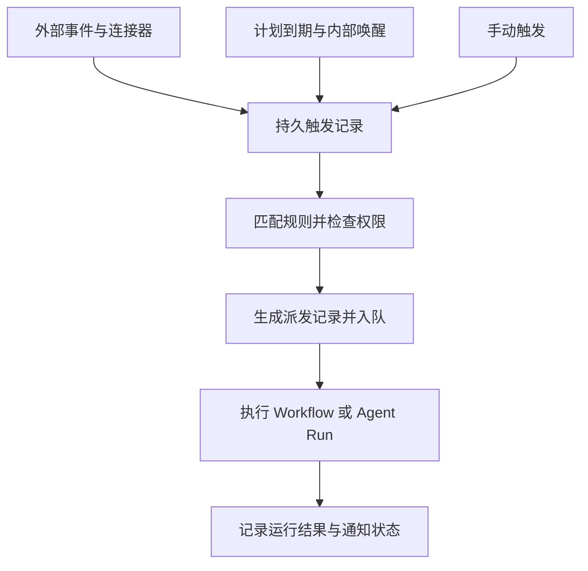

# Agent 的事件触发与定时调度调研

Agent 自动化可以拆成四个产品决策。**什么时候启动、以谁的身份运行、从哪个会话开始、结果送到哪里。** 同一条 GitHub 事件既可以让 Agent 独立审核一次，也可以唤醒正在跟进该 PR 的会话。每天九点生成一份日报，以及等半小时后继续一次尚未完成的任务，也适合使用不同的运行语义。

本文依据截至 2026-11-24 的官方文档和公开实现资料整理。产品对照记录各家公开说明的行为，未做账户实测。后半部分的参考架构和验收场景是设计建议。

## 三个会改变实现的产品差异

**同一条 PR 事件，网络超时后重发，会开几个会话？** 假设调用方按仓库和 PR 编号关联上下文，按每次事件的 ID 去重。OpenAI Workspace Agents 把两者分成 `conversation_key` 和 `Idempotency-Key`，同一触发入口重试同一个键会拿回首次受理结果。Cursor 的 Project automation webhook 还校验正文，同键同正文复用首次运行，同键异正文返回 `422`。Claude Code 的 `/fire` 每次成功请求都会建新会话，响应丢失后重发可能开第二个。同一 PR 的下一次新提交则是新事件，可以沿用会话键，但要有新的事件键。[OpenAI 触发 API](https://learn.chatgpt.com/workspace-agents/trigger-runs) · [Cursor Webhook](https://cursor.com/docs/cloud-agent/automations#webhook-triggers) · [Claude Code 触发 API](https://platform.claude.com/docs/en/api/claude-code/routines-fire#idempotency)

**每天九点检查一次，电脑睡了三天，醒来要跑几次？** Claude Code Desktop 会检查近七天的漏跑，只为最近的到期时刻补一次。CLI 会话如果已退出，恢复后从下一个到期时刻继续。如果会话一直开着，只是 Claude 正忙，则空闲时合并执行一次。对于日报，提示词里的“今天”可能是醒来的日期。需要补某一天的数据时，输入应携带原计划时刻和对应的数据区间。[Desktop 漏跑](https://code.claude.com/docs/en/desktop-scheduled-tasks#missed-runs) · [CLI 会话定时任务](https://code.claude.com/docs/en/scheduled-tasks#limitations)

**点一次“测试”，会不会真的写入外部系统？** Devin 的脚本预检测试会发出脚本中的真实请求，但跳过后续动作并保留旧游标。同一自动化的 **Run now** 会跳过预检并直接执行动作。Grok Bot 的 **Test** 会运行任务、调用已连接工具并消耗额度。产品若同时提供“测试匹配”“测试预检”“立即运行”，应在按钮旁写清是否会调工具、修改数据或推进游标。[Devin Preflight](https://docs.devin.ai/product-guides/automations#configure-and-test-a-preflight-script) · [Grok Bot 测试](https://docs.x.ai/grok-bot/skills-routines-and-automations#test-before-enabling)

## 产品对照

这批产品有三种常见做法。Claude Code、Cursor 和 Devin 让时间或事件直接启动自动化任务；Rovo 和 n8n 先启动工作流，再在需要判断的步骤调用 Agent；LangSmith Agent Server 把选择哪条会话、是否保留状态交给运行 API。比较时先看谁拥有本次运行，再看它支持哪些入口。

| 产品 | 事件与时间怎么接入 | 执行与设计取舍 |
| --- | --- | --- |
| ChatGPT / Codex | 在符合条件的 ChatGPT 网页与移动端，单个任务可订阅多种 Gmail、Slack 或 GitHub PR 事件。若还要定时检查，需另建任务。桌面端的项目定时任务可以在本地项目或独立 worktree 中执行。 | 聊天内定时任务沿用该聊天，独立定时任务每轮新开聊天。短时间内的多个匹配事件可能合为一次运行。Team Tasks 在云端使用团队服务账号和已配置连接，成员可查看运行历史。[Scheduled tasks](https://learn.chatgpt.com/docs/automations) · [Team Tasks](https://learn.chatgpt.com/docs/enterprise/teams) |
| Claude Code | 云端 Scheduled Tasks（原 Routines，研究预览）可组合计划、GitHub App 事件与专用 HTTP 入口，任一触发即运行。桌面计划依赖本机应用，CLI `/loop` 依赖当前会话，Channels 可把事件送到正在运行的会话。 | 云端 API 或 GitHub 触发各自创建新会话，项目中的任务也可以续接已有线程。桌面和 CLI 各自定义了漏跑处理，见上文。[云端计划](https://code.claude.com/docs/en/routines) · [桌面计划](https://code.claude.com/docs/en/desktop-scheduled-tasks) · [CLI 计划](https://code.claude.com/docs/en/scheduled-tasks) · [Channels](https://code.claude.com/docs/en/channels) |
| Cursor | Automations 支持 cron、源代码托管事件、Slack、Linear、PagerDuty 和通用 webhook，多触发器按任一条件启动。 | 创建 Cloud Agent run，可选仓库、模型及工具。团队可选择以创建者或自动化专用服务账号运行。Project automations 的 webhook 支持幂等键。另有 Agent SDK 的 Channels，按 PR 或 Slack 线程归属会话、续接后续消息。[Automations](https://cursor.com/docs/cloud-agent/automations) · [Agent SDK](https://cursor.com/changelog/agent-sdk) |
| Devin | 一次性和周期计划、通用 webhook 与 GitHub、GitLab、Jira、Linear、Slack、Teams 等事件可进入一条规则，随后执行结构化条件与可选脚本或模型预检。周期计划使用 RRULE。 | 可启动新会话、给已有会话发消息、在受支持的 Slack 频道使用持久分诊会话，或发通知。逐步开放的脚本预检可以维护游标并按业务项展开，产品还配置单会话开销、触发频率、并发和队列深度。[Devin Automations](https://docs.devin.ai/product-guides/automations) |
| GitHub Copilot app | 自动化可选本地或云端运行，两种环境可用的触发器不同。云端支持时间、仓库 Issue/PR 事件和 API 调用。 | 云端 Issue/PR 规则可要求触发者有写权限、忽略 Copilot 自己产生的事件，并限制运行对 GitHub 资源的写入范围。对外部工具授权另行配置。产品同时暴露额度和工具限制。[Copilot App Automations](https://docs.github.com/en/copilot/how-tos/github-copilot-app/using-automations) |
| Grok Bot | Routine 可响应时间、Slack、GitHub、Linear、Sentry、PagerDuty、发往 Bot 地址的邮件及通用 webhook。Webhook 有专用 Bearer key，可接收 JSON。 | Skill 表达可复用方法，Routine 保存何时运行与本次指令。Webhook 的 HTTP 成功表示接受并启动运行，结果在 Bot 会话里查看。运行历史与频率限制在产品中可见。[Skills and routines](https://docs.x.ai/grok-bot/skills-routines-and-automations) |
| Microsoft Copilot Studio | Power Automate 连接器负责外部事件和 Recurrence，再把事件数据和可选的本次指令送入 Agent。 | Agent 可选择调用主题或动作。标准运行环境中需要认证的触发器使用制作者配置的连接。Microsoft Copilot 运行环境的预览功能允许接收者用自己的连接激活共享 Agent。发布前可选择最近收到的事件数据测试，运行后可在活动记录查看实际步骤。[标准环境](https://learn.microsoft.com/en-us/microsoft-copilot-studio/authoring-triggers-about) · [测试与发布](https://learn.microsoft.com/en-us/microsoft-copilot-studio/authoring-trigger-event) · [共享与激活预览](https://learn.microsoft.com/en-us/microsoft-copilot-studio/agents-experience/authoring-add-event-trigger) |
| Atlassian Rovo | Jira Automation 提供定时、产品内原生事件、入站 webhook 和条件；`Use agent` 是工作流中的一个动作。 | 例如每两天早上八点查询 Jira 事项，交给 Agent 写摘要，下一步用 `{{agentResponse}}` 把摘要发到 Slack。什么时候查询和往哪里发都由工作流决定。[Rovo 自动化](https://support.atlassian.com/rovo/docs/agents-in-automations/) · [Jira 触发器](https://support.atlassian.com/cloud-automation/docs/jira-automation-triggers/) |
| OpenClaw | Gateway 提供一次性、间隔和 cron，亦有命令型条件监视器。入站 `/hooks/wake` 可唤醒会话，`/hooks/agent` 可启动独立 Agent 运行，支持自定义事件映射。 | 官方技术文档说明任务定义、运行状态和历史持久化在 SQLite 中。同会话运行等会话空闲。若执行成功但必需的结果投递失败，历史分别记录执行成功与整体失败，单纯的投递故障不会让 Agent 再跑一遍。[Gateway 实现](https://docs.openclaw.ai/automation/cron-jobs/how-it-works) · [计划与条件监视](https://docs.openclaw.ai/automation/cron-jobs/schedules) · [Webhook](https://docs.openclaw.ai/automation/cron-jobs/webhooks) · [运行历史](https://docs.openclaw.ai/automation/cron-jobs/managing-jobs) |
| Hermes Agent | Webhook 可启动独立运行，也可唤起已有 cron job，让周期扫描作为兜底。事件数据作为本次上下文，任务原有提示词保持稳定。Cron 支持无模型脚本、脚本预判，以及由网关或托管调度器触发。 | 独立运行的 webhook 路由可按业务对象合并多个不同事件，并设最长等待。任务可独立配置漏跑与结果投递，适合参考低成本监控和可插拔调度入口。[Cron](https://hermes-agent.nousresearch.com/docs/user-guide/features/cron) · [Webhooks](https://hermes-agent.nousresearch.com/docs/user-guide/messaging/webhooks) · [Cron internals](https://hermes-agent.nousresearch.com/docs/developer-guide/cron-internals) |
| Dify | Workflow 可有多个触发节点，定时节点最多一个，另有连接器订阅和通用 webhook。连接器可通过授权自动订阅，或让用户在外部系统配置回调。 | 与执行日志关联，能看到本次运行起因。Webhook 有调试和生产入口，可测试输入映射。适合参考面向构建者的触发节点和连接复用。[触发节点](https://docs.dify.ai/en/cloud/use-dify/nodes/trigger/overview) · [插件订阅](https://docs.dify.ai/en/self-host/use-dify/nodes/trigger/plugin-trigger) · [Webhook](https://docs.dify.ai/en/cloud/use-dify/nodes/trigger/webhook-trigger) |
| n8n | Schedule、Webhook 与按游标轮询等入口启动工作流，Agent 可以作为流程内的处理节点。持久调度器提前物化到期实例，再由数据库协调领取。 | 自托管持久调度器会执行宽限期内的迟到实例；超过后可跳过，或按节点、按触发规则补最近一次。启用可选的持久轮询游标后，游标与所生成的执行记录可一起保存。Queue mode 让单独的 worker 消费执行 ID。[Durable scheduler](https://docs.n8n.io/deploy/host-n8n/configure-n8n/durable-scheduler) · [Queue mode](https://docs.n8n.io/deploy/host-n8n/configure-n8n/scaling/enable-queue-mode) · [Webhook 节点](https://docs.n8n.io/integrations/builtin/core-nodes/n8n-nodes-base.webhook/) |
| OpenHands Agent Canvas | 定时、webhook、按事件源匹配三种入口。事件源可以独立注册和验签，再用事件名和结构化条件把一次投递分发给多个自动化。 | 既可运行 Agent 指令，也可走脚本自动化。脚本可以轮询和去重，仅在需要判断时才调用模型。纯脚本运行保留日志，无需创建 Agent 对话。[自动化管理](https://docs.openhands.dev/openhands/usage/agent-canvas/managing-automations) · [事件源](https://docs.openhands.dev/openhands/usage/agent-canvas/automation-events) · [脚本自动化](https://docs.openhands.dev/openhands/usage/agent-canvas/prebuilt-automations) |
| LangSmith Agent Server | Cron 可定期向指定的 assistant 提交固定输入，外部调用方也可走 Runs API。 | 绑定已有 thread 时，每轮延续其上下文；无状态 cron 每轮仍会创建新 thread，完成后默认删除，也可配置保留供追查。[Cron jobs](https://docs.langchain.com/langsmith/cron-jobs) · [Agent Server](https://docs.langchain.com/langsmith/agent-server) |

还有两类可参考的入口。Gemini Tasks 向 Google AI Pro/Ultra 用户提供专题变化和 Gmail 条件监控。Google 将它定位为容许延迟的跟踪任务，时间敏感的告警需要另外的到达保证。OpenHands 也提供由各仓库的 GitHub Actions 按 PR 标签或评审请求发起运行的示例，适合利用已有 CI 事件入口。[Gemini Tasks](https://support.google.com/gemini/answer/17094710?hl=en) · [OpenHands 自动化评审](https://docs.openhands.dev/openhands/usage/use-cases/code-review)

对需要跟踪结果的程序，OpenAI Workspace Agents 在事件持久入队后返回 `202` 和会话链接。触发时启用状态查询的 beta 选项，还可获得运行 ID，轮询区分派发失败与运行失败。Claude Managed Agents 的 `deployment_run.succeeded` 则明确表示调度器成功创建了会话，Agent 后来做了什么要继续看该会话的事件。[Trigger workspace agent runs](https://learn.chatgpt.com/workspace-agents/trigger-runs) · [Managed Agents 运行事件](https://platform.claude.com/docs/en/managed-agents/webhooks)

## 可迁移的设计思路

1. **把自动化定义和触发器分开。** 定义保存目标、可信指令、输入映射、执行身份和结果策略；触发器保存何时派发。Claude Code、Cursor、Devin 和 Dify 展示了多入口共用一个目标的价值。ChatGPT 允许多个事件入口，却将时间计划单列；产品也可以按来源是否允许混用来控制配置复杂度。关键信息是历史上能回答本次由哪条规则触发。
2. **把会话路由和触发类型分开。** 可按次新开、固定续接、按外部对象键续接。交接给现有会话时，应排队或进入其输入收件箱。按 `PR`、工单或聊天线程维持会话，能够保留上下文，也需要权限复核、串行语义和明确的会话回收机制。通知回到某个聊天和 Agent 在该聊天中执行是两项配置。
3. **把高频输入先交给确定性筛选。** 连接器负责匹配提供方、仓库、项目、事件和动作类型。再根据状态版本、游标或业务键判断是否变化，最后才调用模型做语义理解。Hermes 的预检脚本、Devin 的 Preflight、Copilot 的事件来源过滤，分别解决无变化轮询、复杂门槛和自动化回路。可合并短时间内同一 PR 的若干更新，同时保留原始投递记录及触发原因。
4. **把入口权限和执行权限分开。** 请求确由某个连接器送达，只证明事件来源。系统另需判断触发人能否启动此规则、运行身份还能否访问范围内对象、Agent 可以调用哪些工具。个人例行检查可绑定个人连接，团队长期自动化可用可撤销的服务身份。保存的提示词和外部事件正文分别作为可信任务配置和外部数据传给 Agent，事件字段中的文本不能授权工具动作。
5. **以行为结果定义成功。** 接收成功、已入队、开始运行、业务目标达成、结果送达可以各有状态。通知可设为仅有变化、失败或需人工处理时发送。补发结果与重跑 Agent 是不同操作，对已执行的外部动作尤其重要。Anthropic 的公开架构文章列出 inbox、timers、memory、permissions 和 outbox 五项职责。[Building always-on agents](https://claude.com/resources/articles/building-always-on-agents)

## 参考架构

这是一种逻辑划分。同一个服务、数据库事务和队列可以覆盖若干节点。在已有 Workflow 的产品中，一条自动化可以指向包含一个 Agent 步骤的 Workflow，运行状态和取消权继续归现有执行系统。持久触发记录保存输入，派发记录关联目标，执行引擎仍负责运行生命周期。

| 记录 | 建议保留的最小信息 |
| --- | --- |
| 自动化规则 | 所属工作空间、状态、配置版本、目标、运行主体、受信任指令、会话与通知策略。 |
| 触发器 | 类型、启停状态、订阅条件或时间表达式、连接引用、下次到期时间。 |
| 触发记录 | 来源连接、事件 ID、类型、业务对象键、发生与接收时间、必要字段或原始内容引用。计划事件保存原定时刻。 |
| 派发记录 | 匹配到的规则与版本、触发记录、幂等键、跳过或失败原因、重试次数、执行 ID。 |

一个外部事件可以匹配不同规则，所以接收记录和派发记录的去重边界不同。同一次业务检查也可能由 webhook 和兜底计划分别触发，检查当前对象版本或业务水位才能识别已经处理的工作。CloudEvents 要求生产者让 `source` 与 `id` 的组合唯一。`type` 和 `specversion` 也属于必填属性；是否携带 `subject`、`time` 与 `data` 取决于事件。多租户系统在去重作用域中还需绑定租户和实际授权的连接。[CloudEvents 规范](https://github.com/cloudevents/spec/blob/v1.0.2/cloudevents/spec.md) · [Inngest 事件与触发器](https://www.inngest.com/docs/durable-execution/guides-and-advanced/events-and-triggers/event-and-trigger-concepts)

### 外部事件怎么收

- **可信服务显式调用。** 受控系统或 CI 调用创建运行 API，提供稳定的业务幂等键。适合第一条端到端集成，也能为完整连接器提供对照。
- **每条规则的通用 webhook。** 接收端绑定规则和执行授权，可使用可轮换的密钥或签名协议。响应返回投递或运行引用。若允许没有外部 ID 的调用，应让接入方知道同一次请求重发的结果，并为可重试调用提供稳定键。
- **原生连接器订阅。** 平台用提供方相应协议验签、解析连接和租户、按类型映射字段，再提交持久事件。例如 GitHub 要求接收端在 10 秒内返回 `2xx`。失败的投递需由接入方手动或用程序发起重投，重投沿用原 `X-GitHub-Delivery`。接入时应为重投或定期对账指定负责人。回调正文里的租户标识不能自行选择执行权限。[GitHub webhook 指南](https://docs.github.com/en/webhooks/using-webhooks/best-practices-for-using-webhooks) · [失败投递](https://docs.github.com/en/webhooks/using-webhooks/handling-failed-webhook-deliveries)
- **轮询适配器。** 无推送或需要兜底时，由定时器读取增量并标准化为外部事件。事件保存与游标推进需要一致性，重启时从持久游标恢复。处理迟到与乱序时，可基于对象版本检查当前状态。轮询任务本身通常可以由代码完成。

### 时间语义怎么定

| 决策 | 可以采用的语义 |
| --- | --- |
| 时间表达 | 区分一次性绝对时间、固定间隔和墙上时钟日历规则。“每 24 小时”和“当地每天 9 点”遇到夏令时可能出现不同结果。保存时区、原始规则和下次 UTC 到期时刻，提供下次运行预览。 |
| 夏令时 | 为不存在的当地时间与重复的当地时间定义行为。例如当地时钟回拨，当天的 01:30 出现两次。对按该时区配置的日历规则，EventBridge Scheduler 只执行一次，Claude Managed Agents 的 scheduled deployment 会触发两次；两家都会跳过春季不存在的时刻。[EventBridge Scheduler](https://docs.aws.amazon.com/scheduler/latest/UserGuide/schedule-types.html) · [Claude Managed Agents](https://platform.claude.com/docs/en/managed-agents/scheduled-deployments) |
| 漏跑 | 可按任务选择跳过、仅补最近一次或在有界窗口补齐。周报晚几分钟可能仍有价值，旧告警检查可能已经失效。记录原定时间和实际派发时间，人工回填另有入口。 |
| 运行重叠 | 可跳过、缓冲一次、逐个排队或允许并行。共享会话或写同一外部对象时，按会话或业务对象键串行。定时器是否重叠、同一会话是否可并发、租户并发额度是不同约束。 |
| 编辑、暂停、补跑 | 说明在途运行和已排队派发各受什么影响。通常可以做到暂停未来派发，取消已有运行由其生命周期处理。手动测试默认是额外一次触发，保留原定计划。 |
| 主动跟进 | 一次性唤醒可与任务 ID 关联，写明原因和截止条件。外部所等事件提前到达、目标完成或用户取消时，撤销未到期的唤醒。 |

Temporal 对重叠、漏跑和人工回填的分开建模值得借鉴。它的公开架构还展示了把发生时刻计算、缓冲与启动工作流分成独立步骤。AWS EventBridge Scheduler 则把调度投递失败的重试时长、次数和死信队列设为调度器配置。[Temporal Schedules](https://docs.temporal.io/schedule) · [Temporal 调度实现](https://github.com/temporalio/temporal/blob/main/docs/architecture/schedules.md) · [EventBridge 重试策略](https://docs.aws.amazon.com/scheduler/latest/APIReference/API_RetryPolicy.html) · [EventBridge Scheduler 死信队列](https://docs.aws.amazon.com/scheduler/latest/UserGuide/configuring-schedule-dlq.html)

### 三层幂等分别保证什么

| 层 | 稳定键示例 | 恢复时应有的行为 |
| --- | --- | --- |
| 投递 | 工作空间、来源连接、提供方投递 ID | 同一投递多次到达时复用已有记录。定时任务用触发器与原定 UTC 时刻形成逻辑发生 ID。 |
| 派发 | 触发记录、规则 ID，或明确的业务去重键 | 同一规则重复匹配时只创建一份派发。同一事件仍可以启动其他规则。先由事务将状态与入队意图一起保存，或使用同库事务入队。 |
| 外部动作 | 工单创建、通知、评论等具体动作的稳定键 | 尽量复用外部 API 的幂等键或核对回执。动作成功后连接中断、结果未知时，保留可排查状态。 |

生产系统可以围绕已接受的触发记录实现至少一次派发尝试，再加上各层幂等。跨系统外部动作的执行保证取决于目标 API 及业务回执。收件持久化、Run 创建、Run 本身与结果通知适合分别记录重试和退避。重试耗尽后应保留失败原因、可查询的状态和人工修复入口。[AWS Transactional outbox](https://docs.aws.amazon.com/prescriptive-guidance/latest/cloud-design-patterns/transactional-outbox.html)

Trigger.dev 的公开实现说明给出一个容易漏掉的窗口。服务先领取事件 ID，再持久入队，最后确认领取并返回成功。遇到进程在中途退出，重投可以使用相同队列 ID 恢复未确认的领取。后台执行还有一层带有效期的 Run 幂等键。相同入口还可派发新任务、向 Agent 会话投递或恢复等待中的任务，可分别定义关联键和重放语义。[Trigger.dev webhook 实现](https://trigger.dev/blog/how-we-built-webhooks) · [等待外部事件](https://trigger.dev/human-in-the-loop-ai-agents)

## 三条可选的落地路线

| 路线 | 适合的情况 | 需要承担的工作 |
| --- | --- | --- |
| 复用数据库、队列和现有 Workflow | 产品已能可靠创建后台 Run，也有可用的计划扫描。 | 增加统一触发配置、外部收件与匹配、历史关联和幂等。可用少量固定调度任务扫描业务计划，再复用队列执行。Graphile Worker 也把其静态 crontab 定位在少量系统级任务，用户规则适合单独储存。[Graphile Recurring tasks](https://worker.graphile.org/docs/cron) |
| 将事件接入或时间唤醒托管出去 | 接入很多 SaaS，或希望宿主可缩容到零。 | 外部调度器、连接平台或 CI 负责唤醒，自己的 API 负责鉴权、幂等、运行映射和审计。要处理对方与本地配置之间的同步及故障重试。 |
| 引入持久工作流引擎 | 产品需要跨天运行、长时间等待事件或审批、复杂回填、可恢复的步骤级执行。 | 评估 Temporal、Inngest 等是否能简化当前缺失的部分。既有 Agent 会话持久化、工具授权、运行审计与引擎状态的关系仍要定义。 |

如果从已有 Agent 平台开始，可以先把定时和 webhook 各做成一条完整路径，共用派发与执行。产品入口支持启停、立即运行、查看上次和下次时间、查看跳过或失败原因。选择一个具有稳定身份与业务对象的事件，比如「指定仓库的 PR 收到 review」，先做可见结果。再验证同一 PR 重复投递、两种触发交错与授权撤销。随后按真实需求增加原生连接器、多触发器、固定会话续接、合并以及回填。

较有区分度的第二阶段场景有三个。

- **事件加对账。** PR 更新时立即检查，每晚补查遗漏；按 PR 当前版本或反馈游标，只处理新变化。两个入口的运行时间与业务去重键独立记录。
- **按对象续接。** 一条工单对应一个持久会话。工单评论只提交本次结构化输入，Agent 读取当前工单状态后决定下一步，并将结果送到授权的目标。
- **先判定再叫醒。** 周期预检只查是否变化。达到条件才开启 Agent 并限额运行，日常无变化时只记检查结果，无需用户通知。

## 待验证的验收场景

| 场景 | 应看到的行为 |
| --- | --- |
| 去重有效期内，两个请求或 worker 处理同一规则的同一投递 | 一份接收、一份匹配派发、可查询同一个 Run 引用。不同规则仍可各自派发。 |
| 入队后重启、或 Run 创建成功但响应丢失 | 能重新领取或找回原 Run，保持本次执行的配置与关联。 |
| 同 PR 冲入多条评论，或机器人自己发出反馈 | 需要合并时按对象合并，保留原因。自身产生的事件按规则抑制，避免回路。 |
| 故障期间越过多个时刻，或发生夏令时切换 | 用明确的漏跑、重叠和当地时区规则预测新运行数，每条记录显示计划时刻和实际时刻。 |
| 挂起时收到事件，或连接撤销时尚有派发待执行 | 运行前检查状态和权限，历史能解释跳过或失败，已运行的写操作保留回执。 |
| Webhook 与定时对账同时发现同一版本 | 按照本规则的业务幂等策略处理一次，保留两条触发来源。 |
| Agent 已完成，通知服务超时 | 关联原 Run 重试投递。结果历史区分业务成功和投递状态。 |

可观测性可从到期至开始延迟、事件接收至开始延迟、待处理队列最老年龄、跳过原因、每条规则的消耗以及重复派发和重复动作的比例开始。需要先明确所期望的延迟和容错，再决定是否升级调度基础设施。

## 关联笔记

- [持久运行与个人 Agent 的设计实现](持久运行与个人%20Agent%20的设计实现.md) 讨论跨多次执行的任务状态、记忆和后台授权。
- [常驻 Agent 的架构与可靠执行](../阅读/常驻%20Agent%20的架构与可靠执行.md) 整理 Anthropic 公开架构文章及动作恢复设计。
- [Agent 专题](README.md)
