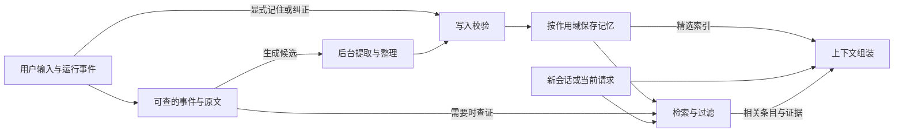

# Agent 长期记忆的设计与实现调研

截至 2026-11-20，公开实现中反复出现的做法是**保留可查的原始记录，提炼少量跨会话知识，把启动时注入的内容控制在小预算内，再按当前任务读取详情**。例如，Hermes 把短笔记与历史全文搜索组合起来，Claude Code 和 Muse Code 用索引引导按需读取，Codex 和 Grok Build 在后台整理旧会话。向量检索、时态图谱和周期性整理分别解决召回、变化追踪和维护问题，可以独立采用。 [Hermes](https://hermes-agent.nousresearch.com/docs/user-guide/features/memory) · [Claude Code](https://code.claude.com/docs/en/memory) · [Anthropic 记忆研究](https://www.anthropic.com/research/components-of-agent-memory)

本文依据官方文档、项目仓库和原始研究。产品部分描述资料所能确认的功能与实现，架构与验收部分是从这些机制推导的设计判断。各产品的闭源内部细节和实际运行表现仍需实测。这里的 Muse 指 Meta 的个人 Agent，另列 Meta 的终端产品 Muse Code。DeepSeek Harness 指官方 `deepseek-harness` 项目。

## 先确定要跨会话保留什么

| 对象 | 保留的内容 | 读取方式 |
| --- | --- | --- |
| 会话状态 | 当前目标、近期消息、工具结果、检查点与压缩摘要 | 恢复原会话或继续当前运行 |
| 情节记忆 | 过去发生过的事、用户原话、失败尝试、结果与证据 | 通过时间、关键词、会话 ID 或语义搜索回查 |
| 语义记忆 | 经提炼的持久偏好、项目信息、曾确认的事实和决策 | 少量常用信息预加载，其余依任务召回 |
| 程序性记忆 | 经验证的步骤、排查办法、可重复的工具用法 | 作为 Skill、runbook 或经验条目按需加载 |
| 正式记录 | 项目规则、当前任务状态、审批与外部动作回执 | 从仓库、任务系统或权限服务读取权威值 |

历史记录、知识条目和上下文压缩可以同时存在。能够恢复旧线程，表示系统保存了该线程的状态。能够搜索旧线程，表示新线程可以查原始素材。自动提炼则多了写入决策，系统从旧事件中选出值得复用的内容，并负责更新和遗忘。这里关注运行时保存到文件、数据库或服务中的外部记忆。 [Anthropic 记忆研究](https://www.anthropic.com/research/components-of-agent-memory) · [OpenAI Agents SDK 的 Memory 与 Compaction](https://developers.openai.com/cookbook/examples/agents_sdk/building_reliable_agents_memory_compaction) · [LangGraph 记忆模型](https://docs.langchain.com/oss/python/concepts/memory)

## 点名产品的公开机制

| 产品 | 写入与存储 | 读取、范围和用户控制 |
| --- | --- | --- |
| **Grok Bot** | 自动保留长期偏好、用户事实、规则和带日期的工作记录或摘要。也可在对话中要求记住、查看、纠正或忘记。 | 同一个 Bot 跨聊天和语音沿用记忆。少量用户事实可在本人多个 Bot 之间共享。清空聊天时记忆仍保留。Team Bot 中，普通协作者带来的团队记忆需要所有者或 Manager 批准。推理钩子文档区分了共享记忆与旧消息的压缩摘要，完整召回算法未披露。 [个人 Bot](https://docs.x.ai/grok-bot/bots#what-a-bot-remembers) · [Team Bots](https://docs.x.ai/grok-bot/team-bots#what-it-learns) · [推理钩子](https://docs.x.ai/grok-bot/inference-hooks#messages) |
| **Meta Muse** | 跨对话保留记忆，用户可查看或编辑自己的云 VM 中的记忆文件。`MEMORY.md` 是公开文档给出的例子。Meta 的 Active Memory 资料说明模型经过训练，可判断信息的持久性、过时情况及何时重新相关。 | 可从对话询问记忆，或让 `forget` Skill 在记忆及支撑文件中寻找并尽力移除指定内容。公开资料确认了文件可控与跨对话能力，召回排序和删除覆盖范围仍需实测。 [产品设计](https://muse.ai/blog/how-we-designed-muse) · [记忆控制](https://muse.ai/security-and-privacy) · [Active Memory](https://research.meta.ai/blog/specialized-models-for-muse-and-metaai) |
| **Codex 本地客户端** | Memories 默认关闭。开启后，后台从符合条件且已空闲的聊天分别提取笔记，再汇总为本机记忆文件。CLI 新目录默认用 `memories_v2/`，已有记忆、版本设置和桌面迁移行为会影响目录选择。 | `/memories` 可分别控制本聊天是否使用旧记忆、是否贡献给未来记忆。IDE 扩展使用所连接 Codex 主机的记忆。ChatGPT Work 和网页版 ChatGPT 使用账户或工作区记忆设置。团队固定规范可写进 `AGENTS.md`。 [本地记忆、版本与控制](https://learn.chatgpt.com/docs/customization/memories) · [项目指令](https://learn.chatgpt.com/docs/agent-configuration/agents-md) |
| **Claude Code** | 项目指令由团队或用户维护，Auto Memory 由 Claude 从工作中记录。受支持的本地会话默认开启自动记忆，写入按仓库划分的本地目录，同仓库的 Git worktree 共享。 | 自动加载 `MEMORY.md` 开头，受 200 行或 25 KB 上限约束，主题文件按需读取。可通过 `/memory` 查看相关入口、开启或关闭。当前还支持在特定项目指令条件下直接读 `AGENTS.md`。 [Claude Code 记忆与项目指令](https://code.claude.com/docs/en/memory) |
| **DeepSeek Harness** | 官方核心持久化会话事件，模型视图可压缩，原始事件仍可查。内置项目指令插件加载 `AGENTS.md` 等文件。`v0.2.2-rc.5` 的实验会话搜索为只读能力，Web 和桌面默认关闭，启用后用 SQLite FTS5 建索引。 | 实验工具能在相同工作目录的旧会话中搜索、追踪并读取原文。另有按 `@` 引用注入旧会话片段的可选功能。结构化偏好及经验库可由第三方插件提供。 [会话机制](https://github.com/deepseek-ai/deepseek-harness/blob/master/docs/subsystems/session.md) · [压缩](https://github.com/deepseek-ai/deepseek-harness/blob/master/docs/subsystems/compaction.md) · [固定版本的会话搜索](https://github.com/deepseek-ai/deepseek-harness/blob/dsh-v0.2.2-rc.5/packages/experimental/session-search/README.md) · [会话引用](https://github.com/deepseek-ai/deepseek-harness/blob/master/packages/context/session-reference/README.md) · [第三方记忆插件](https://github.com/Culeot/dsh-agent-memory) |

DeepSeek Harness 官方还提供 Memorix、MCP Reference Memory 和 Engram 的接入示例。这些是默认关闭的外部记忆配置，存储、项目范围、查询和更新语义由接入的服务决定。DeepSeek 团队的 `dsh-superagent-prototype` 另行展示了长期主会话、分工执行会话、持久任务对象，以及先读任务概览再按 ID 查详情的方式。仓库将其定位为研究原型。 [MCP 记忆接入](https://github.com/deepseek-ai/deepseek-harness/blob/master/docs/user/guide/mcp-memory.md) · [原型说明](https://github.com/deepseek-ai/dsh-superagent-prototype) · [原型模型侧接口](https://github.com/deepseek-ai/dsh-superagent-prototype/blob/main/docs/007-architecture.md#model-facing-interfaces)

## 其他主流 Agent 的做法

| 产品 | 可以借鉴的机制 |
| --- | --- |
| **Grok Build** | 在后台检查已完成的对话轮次，把可复用的决策、约定和项目事实写成个人或工作区范围的 Markdown 主题；新请求召回相关主题。`/memory` 查看和管理，`/dream` 整理旧笔记。 [实现说明](https://x.ai/news/grok-build-memory) · [CLI 参考](https://docs.x.ai/build/cli/reference) |
| **Muse Code** | 三个范围分别为本机私有项目、Git 共享项目及本机跨项目。启动注入 `MEMORY.md` 和最多 48 个文件路径组成的索引，详情按需读。后台观察器还可在回答前加入相关笔记。 [配置与上下文](https://dev.meta.ai/docs/muse-code/configuration#local-memory) |
| **GitHub Copilot Memory** | 支持仓库事实和用户偏好两类记忆。仓库事实附代码引用，使用时以当前分支检查引用，支持对记忆有效性投票和自动到期。GitHub 当前官方功能文档给出的仓库记忆默认有效期为 90 天，以创建或最近一次正向投票计。 [Copilot Memory](https://docs.github.com/en/copilot/concepts/prompting-and-context/copilot-memory) |
| **Cursor** | Agent 可按需搜索旧对话。Cursor Projects 有共享项目资料与私有个人存储。Cloud Automations 另有每个自动化自己的持久 `MEMORIES.md`，默认开启且可编辑。早期 Cursor 1.0 的实验性 IDE Memories 已在后续版本下线。 [历史搜索](https://cursor.com/help/ai-features/agent#can-agent-search-my-past-conversations-for-context) · [项目与个人存储](https://cursor.com/docs/agent/projects#context-and-your-personal-store) · [自动化记忆](https://cursor.com/docs/cloud-agent/automations#memories) · [旧功能状态](https://forum.cursor.com/t/are-my-memories-gone/144057/3) |
| **Qwen Code** | `QWEN.md` 用于显式指令，Auto-memory 后台提取偏好、纠正与项目背景，保存为本地 Markdown。支持 `/remember`、`/forget`、`/dream`，另有可选的分层召回和独立团队记忆。按当前文档，同一 checkout 的分支共享项目自动记忆，独立 worktree 有各自的目录。 [记忆文档](https://github.com/QwenLM/qwen-code/blob/main/docs/users/features/memory.md) |
| **Google Antigravity / Gemini CLI** | Antigravity 的 `/learn` 由用户触发，提出具体规则或 Skill 改动，经确认写入全局或工作区文件。Gemini CLI 提供默认关闭的实验性 Auto Memory，启动时异步扫描旧聊天，把候选改动放进收件箱供审阅。 [Antigravity Learn](https://antigravity.google/docs/commands/learn) · [Gemini CLI Auto Memory](https://geminicli.com/docs/cli/auto-memory/) |
| **OpenCode V2** | 通过分层 `AGENTS.md` 保留项目指导，探索子目录时可按需读更具体的规则。压缩保持同一会话可继续，旧消息仍留存。可用这两项分别承载显式项目知识与会话状态。 [项目指令](https://opencode.ai/docs/instructions/) · [会话压缩](https://opencode.ai/docs/compaction/) |
| **OpenClaw** | Markdown 保存原始记忆，SQLite 保存可重建的检索索引。小型精选笔记作为启动上下文，日期日志和已获授权的历史按需查。支持压缩前写回当天日志、Dreaming 整理以及可选的跨私聊召回。 [记忆架构](https://docs.openclaw.ai/concepts/memory-architecture) · [记忆配置](https://docs.openclaw.ai/concepts/memory) |
| **Hermes Agent** | 有字数上限的 `MEMORY.md` 和 `USER.md` 以会话启动快照注入；Agent 用 `memory` 工具修改。`session_search` 通过 SQLite FTS5 查询跨会话实际消息。可以设置写入审批，也能接外部记忆后端。 [持久记忆](https://hermes-agent.nousresearch.com/docs/user-guide/features/memory) |
| **ChatGPT dots** | 使用当前对话、相关 ChatGPT 记忆及 dot 自己保存的笔记。委派出去的任务有单独对话，并收到针对该任务挑选的上下文。 [任务与记忆](https://learn.chatgpt.com/docs/dots/tasks-and-memory) |
| **Claude Duet** | 调研时处于研究预览。继承 Claude 账户记忆，Duet 内的不同频道共享；可依账户设置搜索 Duet 历史及 Claude 项目外聊天。文档分别描述了断开连接器与删除历史对旧信息的影响。 [Claude Duet 帮助](https://support.claude.com/en/articles/17631495-get-started-with-claude-duet) |
| **Manus Projects** | 项目的指令、上传文件和资料为相关任务提供共享上下文。官方说明更新后的指令和文件应用到任务的时点不同。这个案例适合参考如何维护显式项目知识。 [Manus Projects](https://www.manus.im/features/projects) |

写入权限可以随内容的影响范围变化。GitHub Copilot Dreaming 的公开预览允许后台直接增删改记忆，仓库中的指令和 Skills 则通过待审 PR 修改。Grok Team Bot 用角色审批管团队经验，Gemini CLI 用个人收件箱管自动提取候选。这三种机制分别适合比较共享规则变更、团队经验采纳和个人候选审核的成本。 [Copilot Dreaming](https://docs.github.com/en/copilot/concepts/prompting-and-context/copilot-dreaming) · [Team Bots](https://docs.x.ai/grok-bot/team-bots#what-it-learns) · [Gemini CLI 收件箱](https://geminicli.com/docs/cli/auto-memory/#how-to-review-extracted-items)

## 开源组件和托管服务

| 组件 | 存储和读取的取舍 |
| --- | --- |
| **LangGraph / LangMem** | Checkpointer 按 thread 留存运行状态，Store 按命名空间提供跨 thread 的长记忆。开发者可以让 Agent 调记忆工具即时写入，也可以异步抽取整理。Deep Agents 可把 `/memories/` 路由到持久 Store。 [LangGraph 记忆](https://docs.langchain.com/oss/python/concepts/memory) · [LangMem](https://langchain-ai.github.io/langmem/concepts/conceptual_guide/) · [Deep Agents](https://docs.langchain.com/oss/python/deepagents/memory) |
| **Letta** | 当前产品用 Git 支持的 MemFS 在同一 Agent 的会话间共享记忆文件，可固定注入或按需读，支持 `/remember` 及后台整理。旧版 V1 SDK 文档则从常驻 memory blocks、可搜索 archival memory 及历史会话接口来描述分层。 [当前记忆](https://docs.letta.com/configuration/memory) · [旧版 blocks](https://docs.letta.com/v1-sdk/memory/memory-blocks) · [旧版 archival](https://docs.letta.com/v1-sdk/memory/archival-memory) |
| **Mem0 Platform v3** | 自动抽取改为一次模型调用，只追加事实及时间线索。内置实体关联与多信号混合检索，旧事实留作历史以辅助时间推理；应用可走显式更新或删除接口。这里的行为以托管版迁移文档为准。 [v3 迁移说明](https://docs.mem0.ai/migration/platform-v2-to-v3) · [时间推理](https://docs.mem0.ai/platform/features/temporal-reasoning) |
| **Zep / Graphiti** | 从原始消息、文本或结构化事件抽取实体和关系。保留来源以及事实生效时间和系统记录时间，当关系变化时可以让旧边失效并保留历史。支持向量、关键词和按图距离重排等方法。 [图模型](https://help.getzep.com/graph-overview) · [检索](https://help.getzep.com/graphiti/working-with-data/searching) · [Graphiti 仓库](https://github.com/getzep/graphiti) |
| **OpenViking** | 把资源、用户记忆和 Skills 组织到有作用域的 URI 目录。会话提交后可以触发提取和合并；检索可先定位目录，再按摘要、概览和详情逐层加载。 [产品架构](https://www.openviking.ai/product) · [开源仓库](https://github.com/volcengine/OpenViking) |
| **Google ADK / Memory Bank** | 通过回调或调用方选送部分事件或整个会话，由服务抽取并合并记忆。ADK 按用户 ID 和应用名访问，可每轮预加载，也可交给模型按需调用。 [ADK 集成](https://docs.cloud.google.com/gemini-enterprise-agent-platform/scale/memory-bank/use-with-adk) |
| **Amazon Bedrock AgentCore Harness** | 原始事件按 actor 和 session 保存，长期记忆由语义事实、会话摘要、偏好、情节或自定义策略抽取，按命名空间召回。Harness 可用托管、自带或关闭记忆。 [Harness Memory](https://docs.aws.amazon.com/bedrock-agentcore/latest/devguide/harness-memory.html) |
| **OpenAI Agents SDK / Claude Managed Agents** | OpenAI Sandbox Agents 的 `Memory()` 为后续工作区运行保留经验，`Session` 管消息历史。Claude Managed Agents 的 Dreams 异步核对记忆库和历史会话，默认生成可审阅的新库，也支持显式写回原库。 [Sandbox Agents](https://developers.openai.com/api/docs/guides/agents/sandboxes) · [Dreams API](https://platform.claude.com/docs/en/api/http/beta/dreams/create) · [Claude 做梦机制详解](Claude%20如何通过做梦整理跨会话记忆.md) |

## 参考架构

下面的图示把案例中可组合的做法放进一条读写链路。

### 写入与维护

1. **优先处理显式操作。** “一直按北京时间排期”可以直接写入，并反馈实际保存的范围。“这次用北京时间”只对当前任务生效。将显式记住、纠正和忘记做成可确认结果的操作。
2. **把自动发现写成候选。** 来源可以是本轮用户纠正、一次有验证结果的工作、或会话结束后的提炼。根据复用价值、来源、敏感程度和作用域决定是否入库。多次验证过的流程可提炼成 Skill。外部内容和模型自己的猜测可以留下证据或候选，进入用户档案需要单独的确认依据。
3. **给记忆附来源和时间。** 最小记录可包含 `id`、类别、所有者与作用域、正文、来源引用、记录时间、状态。对经常变化的事实另记生效时间和被替代的条目。原始来源的内容可能证明曾经出现过一个说法，事实当前是否有效还要结合权威数据。
4. **后台处理慢任务。** 对重复条目做合并，校验过时的事实，将高价值经验提升到索引，清理无价值候选。任务结束、空闲期或累积足够新事件都可触发。对相同事件做幂等处理，合并时检查版本，避免旧后台作业覆盖用户刚做的纠正。
5. **让忘记覆盖召回路径。** 对当前条目、索引、派生摘要和缓存明确失效范围。用户删除可先设置抑制标记，在异步重建完成前持续生效，并防止保留的旧历史被再次提炼回来。能否保留事件原文、如何清理备份，应由产品的数据保留规则明确。

### 读取与使用

1. **先限定可见范围和有效状态，再排序。** 分开会话、个人、项目、团队及租户身份。普通历史、私有偏好、团队规范的可见性和写入者分别控制。记忆可能影响回答，实际执行仍使用权限服务的实时授权。
2. **让低成本索引承担路由。** 只预载少量稳定偏好、项目入口和记忆主题索引。具体命令、旧结论和原话按需读正文。以关键词处理文件名、工单 ID 和原话，以向量处理表达不同但语义接近的请求；候选多时再加重排。让召回条目能回到原文或实际工具结果。
3. **给时间敏感的条目明确优先级。** 判断当前事实、某一时点的事实、未来计划和推测分别用不同条件。发现冲突时查最新记录或原系统，表达不确定性。把记忆还原成事实的过程需要可观测，例如记录为何取这一条、是否核对过来源、向模型注入了多少内容。

存储可以按实际需求递进。少量单 Agent 知识用 Markdown 和主题索引容易检查、迁移和人工修改。多会话历史可用 SQLite 或关系数据库全文检索。跨措辞漏召回有实际证据时再加向量。跨人物、项目和时间的关联查询成为常态时，再比较带有效期的关系表与时态图。原始记录和正式业务数据应有稳定引用，模型生成的摘要与索引可以重建。

## 如何判断记忆真的有用

LongMemEval 覆盖跨对话的信息提取、多会话推理、时间推理、知识更新和证据不足时的拒答。LoCoMo 从长对话考查问答、事件总结等能力。LongMemEval-V2 改用更贴近工具 Agent 的长程 Web 轨迹，检查静态和动态环境状态、操作流程、常见陷阱及错误前提识别。几套评测回答的问题不同，应结合实际任务评估。 [LongMemEval](https://arxiv.org/abs/2410.10813) · [LoCoMo](https://aclanthology.org/2024.acl-long.747/) · [LongMemEval-V2](https://arxiv.org/abs/2605.12493)

| 验收场景 | 检查项 |
| --- | --- |
| 用户在两次独立会话中更改默认偏好 | 新任务用当前值；历史问题能引用旧值和生效时间 |
| 用户要求忘记一条信息，随后后台重建索引 | 相关正文、摘要、缓存与召回结果符合删除语义；旧原文未使它复活 |
| 同名项目出现在两个工作区，或私人偏好被团队 Agent 查询 | 查询、引用和模型实际收到的上下文均符合访问范围 |
| 原文只有一次性指令、玩笑或未经验证的工作结论 | 自动写入拒绝或保留为候选，后续任务没有把它当默认事实 |
| 新任务与旧任务表达完全不同，但使用同一排查步骤 | Agent 找到适用的经验，核对适用条件，并完成任务 |
| 无关任务与缺证据问题 | 很少召回无关条目，找不到证据时能说明缺口 |

比较方案时固定同一个模型和任务集，保留“无长期记忆”“仅搜历史”“短索引加按需检索”等基线。分别记录证据召回率、正确写入率、误用率、更新生效时间、跨范围泄漏、最终任务成功率、输入 token、读写延迟及后台成本。Anthropic 的一个内部资料实验中，搜索加逐步生成的 Wiki 优于仅搜索；另一项偏单文档事实查找的评测里，Wiki 未显示明确收益。是否值得维护中间知识层，取决于本地任务的证据分布及查询成本。 [Anthropic 记忆研究实验](https://www.anthropic.com/research/components-of-agent-memory)

## 关联笔记

[Agent 专题](README.md) · [持久运行与个人 Agent 的设计实现](持久运行与个人%20Agent%20的设计实现.md) · [常驻 Agent 的架构与可靠执行](../阅读/常驻%20Agent%20的架构与可靠执行.md)

原始记录--》总结：记忆/潜在问题/汇总/工作流优化方向

记忆是一种被总结出来的信息

tag：user

个人的记忆：我喜欢苹果
工作区信息：我喜欢
agent信息：
