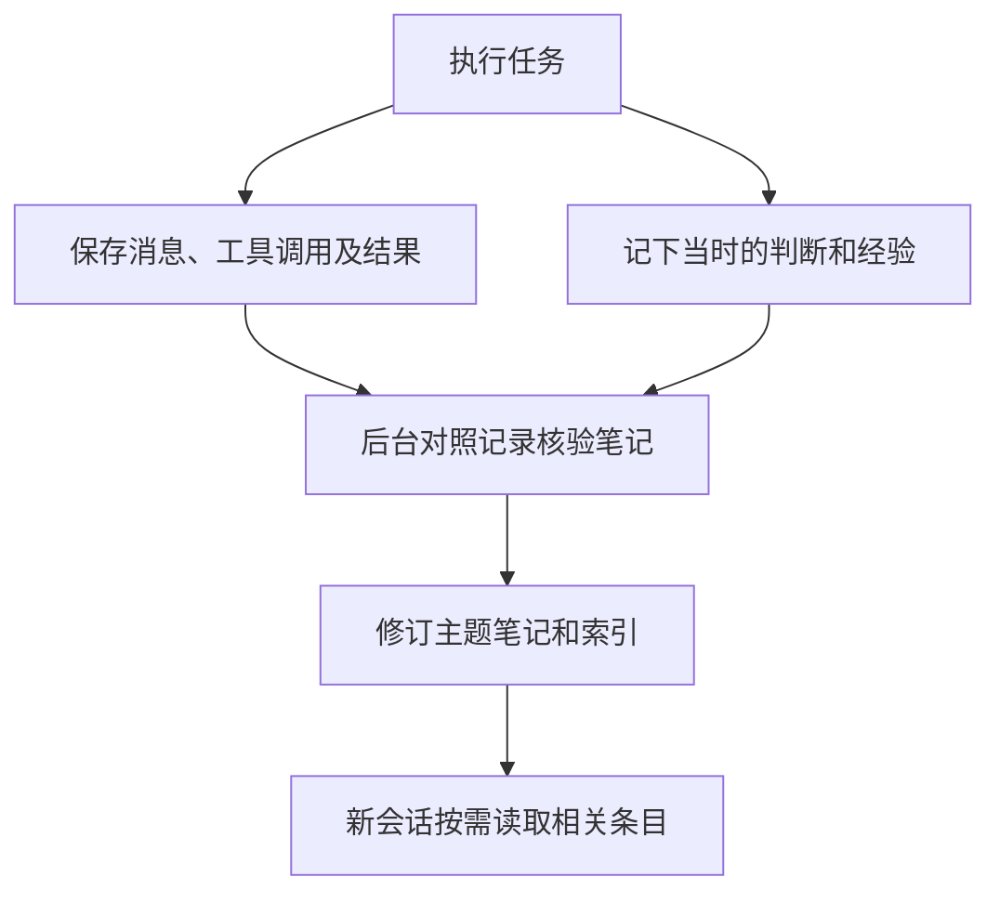

# Claude 如何通过“做梦”整理跨会话记忆

Anthropic 把 **Claude 在任务结束后重读会话记录、修订长期笔记**的过程称为 *dreaming*（“做梦”）。工作时，Claude 按当时的判断记下有用信息。回顾时，它可以看到当时还没发生的事，比如一条命令后来失败了，或者用户在另一次会话里纠正了它。下一次遇到相同问题，Claude 读到修订过的笔记，便有机会换一种做法。整个过程通过读写外部资料完成，无需更新模型权重。会话压缩解决的是另一个问题，即如何腾出上下文，让**当前任务**继续进行。[Anthropic 的记忆研究](https://www.anthropic.com/research/components-of-agent-memory)

## 为什么要回看原始记录

Anthropic 做过一个《宝可梦》对照实验。Claude 把月见山西侧入口的宝可梦中心误记到了东侧。下次走出中心时，它根据自己的笔记判断“已经过山”，于是朝下一座城市走，又从单向台阶掉回了来路。沿用旧笔记的那次运行，Claude 在同一处跌回去三次。[实验经过与地图，见图 7、8](https://www.anthropic.com/research/components-of-agent-memory)

研究人员把含有错误方位的记忆目录交给一次 Dreaming 任务。Claude 对照当时的行动记录，发现“已经过山”与实际路线矛盾，改正了笔记。使用新笔记的那次运行里，Claude 从中心出来后重新进洞，最后抵达了华蓝市。这个例子说明为什么要同时保存**当时发生的事**和**当时得出的结论**。如果只把旧笔记再压短一次，“已经过山”仍然是整理者手里唯一的说法。[Anthropic 的对照实验](https://www.anthropic.com/research/components-of-agent-memory)

## 一条经验怎样进入下一次会话

这里有两次选择。第一次是**写什么**。例如，同一条测试命令在两个版本上表现不同，一条能复用的经验要写清环境、命令和适用版本。第二次是**读什么**。主题页可以保存验证过程，短索引只需告诉 Claude 去哪里找。这样既保留了细节，也节省每个新会话的上下文。在 Anthropic 的实验中，相互链接的主题页有助于回答需要综合多份资料的问题。答案集中在一份可搜索文档时，额外建 Wiki 没有显示出明确收益。[记忆分层与检索实验，见图 9–13](https://www.anthropic.com/research/components-of-agent-memory)

## 官方示例怎样实现整理

Anthropic 的 Cookbook 提供了一个能检查代码和提示词的实现。它把已结束的会话逐个导出成只读文件，后台整理任务可以读这些文件、写共享记忆库。示例用 `cron` 每晚处理新会话，运行时间由部署者设定。[Cookbook 工作流程](https://platform.claude.com/cookbook/managed-agents-cma-dreaming-with-a-dynamic-workflow)

1. **先核对一段经历。** 主控 Agent 把每份记录交给一个分析 Agent。分析者读完整段记录，再查找相关旧笔记。如果工具结果推翻了旧说法，它就修订笔记或标出冲突。如果发现原话只是猜测，它会给结论加上限定。某件事在这段记录里没出现，则保留原条目，因为证据可能在别的会话里。[分析 Agent 的公开提示词](https://github.com/anthropics/claude-cookbooks/blob/main/managed_agents/example_data/memory_distill/prompts/analyzer_system.md)
2. **写清经验的适用条件。** 示例项目 `tidewick` 的早期记录显示，运行 `make test` 需要设置 `TIDEWICK_DATA_DIR`，后续版本取消了这个要求。整理后的笔记应写清这项变化。这样维护旧版的人仍能找到原因，使用新版的人也不会沿用过时的步骤。[Cookbook 示例数据说明](https://platform.claude.com/cookbook/managed-agents-cma-dreaming-with-a-dynamic-workflow)
3. **等全部分析完成，再统一整理。** 一个整理 Agent 合并重复主题、修复链接、补全 `_index.md`。下次工作会话只读挂载这个库，遇到测试问题就能顺着索引找到该项目的主题页。索引和主题笔记都是可以打开检查的文件。[可运行的 Notebook](https://github.com/anthropics/claude-cookbooks/blob/main/managed_agents/CMA_dreaming_with_a_dynamic_workflow.ipynb)

## 托管 Dreams API 怎样接入

截至 2026-11-27，Claude Managed Agents 的 Dreams 处于研究预览。开发者调用 `POST /v1/dreams`，提交同一工作区的一个记忆库、1 至 100 个历史会话 ID 和模型。可选的 `instructions` 用来指定整理重点，例如优先保留用户反复纠正过的项目约定。服务异步执行，调用方可按任务 ID 查询状态，也能通过底层会话的事件流查看正在读写什么。上面的分析与整理分工来自公开 Cookbook，托管接口对外约定的是输入、状态和输出。[Dreams 指南](https://platform.claude.com/docs/en/managed-agents/dreams) · [创建接口](https://platform.claude.com/docs/en/api/http/beta/dreams/create)

| 写入方式 | 整理结果怎样生效 |
| --- | --- |
| 默认 `create_new` | 服务复制输入库，在副本中整理。任务完成后，调用方可以检查结果，再把新库挂到后续会话。继续挂旧库的会话仍会读到旧笔记。 |
| 显式 `update_existing` | 有写权限的调用方可直接更新同一个输入库。后续挂载这个库的会话能读到修订结果。同一库上已有原地整理任务时，另一次原地整理请求会收到 HTTP 409。 |

“挂载”决定 Claude **能读哪些资料**。平台会在系统提示里放入库名、目录位置、访问方式和使用说明，Claude 再用文件工具读取相关正文。默认生成新库时，拿到输出库 ID 只代表副本已建立，等到任务状态为 `completed` 才表示整理成功。这样可以分清“文件在哪里”“整理是否结束”和“这次会话实际读了什么”。[API 写入模式](https://platform.claude.com/docs/en/api/http/beta/dreams/create) · [任务生命周期](https://platform.claude.com/docs/en/managed-agents/dreams) · [记忆库挂载规则](https://platform.claude.com/docs/en/managed-agents/memory)

## 在 Claude Code 和普通聊天里能看到什么

**Claude Code** 的自动记忆按仓库保存为 Markdown。启动时只加载 `MEMORY.md` 开头的 200 行或 25 KB，以先达到的上限为准，其余主题文件按需读。关于 **Auto-dream**，维护者在 2026 年 8 月确认，Linux 版 2.1.233 可以在 `/memory` 里切换后台整理，当时的版本没有手动 `/dream` 命令。这份说明没有给出固定的运行间隔或会话数。[Claude Code 记忆文档](https://code.claude.com/docs/en/memory) · [维护者的版本说明](https://github.com/anthropics/claude-code/issues/39135#issuecomment-5348064388)

**普通 Claude 聊天**的帮助文档介绍的是对话中按主题保存的记忆，以及按需搜索历史聊天。仅凭聊天窗口记住了一项偏好，无法判断它是否运行过开发者平台的 Dreams 作业。[Claude 聊天记忆帮助](https://support.claude.com/en/articles/11817273-use-claude-s-chat-search-and-memory-to-build-on-previous-context)

[Agent 长期记忆的设计与实现调研](Agent%20长期记忆的设计与实现调研.md) · [返回 Agent 专题](README.md)
