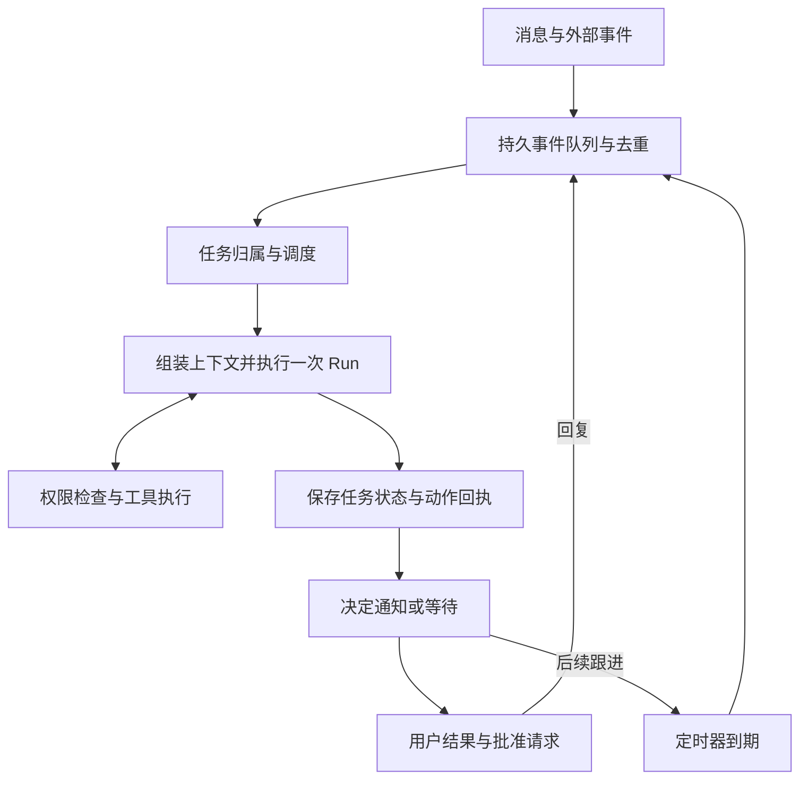

# 持久运行与个人 Agent 的设计实现

持久运行的 Agent 需要在用户离线、任务等待和进程重启后保留目标与状态，并在合适的时机继续工作。Personal Agent 还需要长期维护用户偏好、优先事项和授权。

本笔记综合 Anthropic 文章、DeepSeek Harness、Hermes Agent、Grok Bot 和 Meta Muse 的公开资料。资料核对日期为 2026-11-16；参考架构与实现顺序属于综合建议，尚未在此记录运行验证结果。

## 两个概念

- **持久运行**描述任务生命周期：可以跨多次执行推进，支持等待、恢复与取消。
- **个人 Agent**描述服务对象：围绕一个人的目标、上下文和授权提供服务。

两者可以组合，也可分别存在。常驻服务、持久化数据和持续模型推理应分别设计；系统只在需要理解变化、选择方法或处理例外时调用模型。

## 参考对象各自解决什么问题

| 对象 | 公开资料中的重点 | 借鉴方向 |
| --- | --- | --- |
| Anthropic 文章 | Inbox、Timers、Memory、Permissions、Outbox 五个组件。 | 跨次执行的基础闭环。[原文](https://claude.com/resources/articles/building-always-on-agents) |
| DeepSeek Harness | 以插件组织能力；团队的 Super-agent 原型进一步展示事件、任务、执行与恢复机制。 | 运行框架与任务编排。[Harness](https://github.com/deepseek-ai/deepseek-harness)、[原型架构](https://github.com/deepseek-ai/dsh-superagent-prototype/blob/main/docs/007-architecture.md) |
| Hermes Agent | 跨会话记忆、历史检索、Skills 与定时任务。 | 用户上下文和经验复用。[官方项目](https://github.com/NousResearch/hermes-agent) |
| Grok Bot | 持久云电脑、连接器、角色记忆、后台工作与主动跟进。 | 委派体验和多入口协作。[工作机制](https://docs.x.ai/grok-bot/how-grok-bot-works) |
| Meta Muse | 长期目标、事件与定时跟进，以及外置权限和凭据服务。 | 个人服务与权限边界。[产品设计](https://muse.ai/blog/how-we-designed-muse)、[安全架构](https://muse.ai/blog/security-and-safety-for-ai-agents-our-approach-with-muse) |

DeepSeek Harness 与 `dsh-superagent-prototype` 应分别理解。后者明确标为团队研究原型，并说明部分设计方向尚未实现，不能视作正式产品的生产保证。[原型说明](https://github.com/deepseek-ai/dsh-superagent-prototype)

这些资料支持归纳相近的能力需求，不能据此认定所有项目采用同一内部机制。

## 六个共同设计方向

1. **目标跨越单次对话。** 将长期任务、会话和一次执行分别管理，任务才能在切换话题、等待回复或重启后继续。原文区分 run 与 session，DeepSeek 原型进一步区分 Ticket 与 Assignment。[任务模型](https://github.com/deepseek-ai/dsh-superagent-prototype/blob/main/docs/001-domain.md)
2. **事件和时间推动下一步。** 消息、外部变化、工具完成和定时器到期都可以触发执行。对没有变化的条件检查，可先运行脚本，再决定是否调用模型。Hermes 同时支持定时、事件触发与无需模型参与的脚本任务。[定时任务文档](https://github.com/NousResearch/hermes-agent/blob/main/website/docs/user-guide/features/cron.md)
3. **连续性保存在上下文之外。** 用户记忆、任务进度、历史记录和动作回执承担不同职责，应分别维护，再按需加载。Hermes 将有限的常驻记忆与历史会话检索结合。[记忆文档](https://github.com/NousResearch/hermes-agent/blob/main/website/docs/user-guide/features/memory.md)
4. **能力通过模块接入。** 工具负责执行动作，Skill 说明方法；插件和连接器提供扩展入口。方法的复用应与权限管理分开，生成新工具不能自动扩大授权。[Hermes Skills](https://hermes-agent.nousresearch.com/docs/user-guide/features/skills)
5. **自主性有明确边界。** 系统需要确认谁能发起任务、允许做什么、何时交还用户。Grok Bot 的主动建议遵循先提出再获得同意的流程，Muse 则通过独立 Sentinel 管理动作授权。[Grok Bot 主动行为](https://docs.x.ai/grok-bot/initiative)、[Muse 授权机制](https://muse.ai/blog/security-and-safety-for-ai-agents-our-approach-with-muse)
6. **后台工作与通知分开。** 是否继续推进任务和是否打扰用户，应是两个决策。DeepSeek 原型强调节省人的注意力，Muse 也说明只在结果有意义或需要输入时通知。[原型设计原则](https://github.com/deepseek-ai/dsh-superagent-prototype/blob/main/docs/000-philosophy.md)、[Muse 产品设计](https://muse.ai/blog/how-we-designed-muse)

## 参考架构

以下为综合设计建议。确定性代码落实事件领取、状态迁移、权限和预算；模型负责理解目标、选择方法与解释结果。第一版的协调器可以采用规则，复杂后再加入模型判断。

按逻辑职责保存数据即可，第一版不必拆成多个服务：

| 对象 | 最少保存的信息 |
| --- | --- |
| Event | 来源、发起者、外部 ID、去重键、关联任务、处理状态。 |
| Task | 目标、完成条件、状态、等待原因、下一步、预算、授权依据。 |
| Run | 任务和会话 ID、输入、检查点、结果、成本、错误。 |
| Memory 与 Skill | 用户偏好、事实来源、更新时间；可复用方法及版本。 |
| Action 与 Approval | 稳定动作 ID、参数版本、执行回执；授权范围和有效期。 |
| Timer 与 Outbox | 到期时间、取消条件；通知去重键和投递状态。 |

单用户部署可先使用 SQLite、一个常驻服务和受限工作环境；多租户或多节点执行时，再评估共享数据库、任务队列和更严格的运行隔离。

## 必须明确的实现边界

- **重试与幂等。** 输入事件去重不能保证外部动作只发生一次。动作成功但回执未保存时，应先核对结果或复用幂等键；结果未知且无法查询时，保留待处理状态。DeepSeek 原型的 outbox 原子记录回执与投递任务，但不能替任意外部系统保证恰好一次执行。[Outbox 代码](https://github.com/deepseek-ai/dsh-superagent-prototype/blob/main/src/app/outbox.ts)
- **等待与取消。** 等待输入时释放执行资源；恢复前检查授权有效期、动作参数和任务状态。取消后清理定时器，并处理仍在进行的调用；已经发生的外部动作可能需要补偿操作。
- **授权与外部内容。** 邮件、网页、工具结果和导入记忆可以提供事实，不能自行扩大授权。凭据及权限判断应位于执行模型之外。[Muse 安全架构](https://muse.ai/blog/security-and-safety-for-ai-agents-our-approach-with-muse)
- **并发与安全隔离。** 同一任务的状态迁移需要锁、租约或版本检查；不同任务访问同一资源时也需协调。Grok Bot 明确说明同一用户的多个 Bot 共享云电脑，不能把 Bot 之间的区分作为安全边界。[官方 FAQ](https://docs.x.ai/grok-bot/faq)
- **成本与注意力。** 限制总预算、执行时长、重试和无进展次数。多次检查没有变化时保持安静，对同一问题避免重复提醒。

会话分离、工作目录分离和操作系统权限隔离，应分别验证。多 Agent 可以用于分工，但第一版宜先做完整的单任务恢复与控制。

## 建议实现顺序

| 阶段 | 重点 | 验收目标 |
| --- | --- | --- |
| 基础执行 | 单一入口、任务状态、工具调用、日志。 | 一次委派可完成、可停止、可追溯。 |
| 持久运行 | 事件、定时器、等待恢复、动作幂等、outbox。 | 重启与重复事件后仍能得到正确结果。 |
| 个人上下文 | 用户记忆、历史检索、Skills、按变化通知。 | 减少重复解释和无价值提醒。 |
| 扩展自主性 | 受限主动发现、多执行者、更多连接器。 | 授权可解释，共享资源可协调。 |

权限边界、模型预算与运行上限从基础执行阶段就应生效。

建议从“关注一个 PR，CI 与评审通过后提醒”这类完整场景开始。保存完成条件和授权，接收变化后查询最新状态；尚未达标就等待，达标后只发送必要通知。用户只授权提醒时，合并 PR 需要另行授权。

验收至少覆盖重复事件、执行中重启、外部动作成功后崩溃、批准过期、等待期间取消和长期无变化。指标可记录恢复成功率、重复动作率、越权动作数、每个完成任务的成本与人工介入次数。这些均为待执行的验证目标。

## 待验证问题

- 并发应按用户、任务还是共享资源隔离？
- 状态、记忆和通知分处不同存储时，如何提交与恢复？
- 外部 API 的幂等有效期能否覆盖任务生命周期？
- 用户指令和记忆如何更新、撤销与淘汰？
- 怎样衡量主动行为带来的有效进展，以及占用的用户注意力？

## 适用范围与关联

适用于长期跟进、监控、研究和跨系统事务。规则固定、输入输出稳定的部分优先使用脚本或普通工作流。

[Agent 专题](README.md) · [常驻 Agent 的架构与可靠执行](../阅读/常驻%20Agent%20的架构与可靠执行.md)
