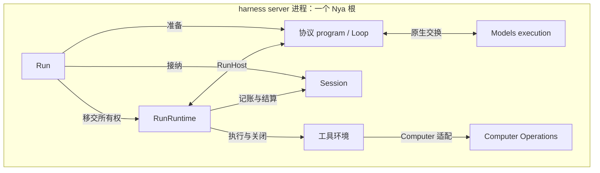
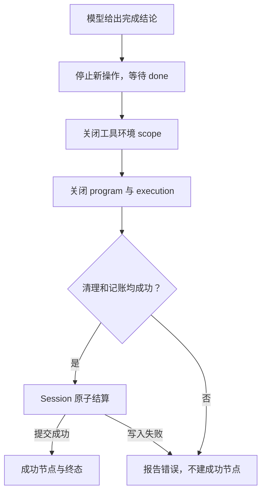

# Anybox Harness 运行时架构

本文回答三个问题：Agent 的一次任务由哪些部分协作完成，运行状态与资源分别由谁持有，以及任务完成、取消或进程异常退出时如何处理。

核对日期为 2026-11-16，依据项目当前实现的静态核对整理。文中的能力说明不等于重新完成了运行测试、跨平台或生产验收；后续实现变化需要同步复核。

## 产品、进程与组件

Anybox 是应用宿主，Anybox Harness 是具体应用，harness server 是该应用的服务端核心。Anybox 提供应用管理、承载与退出协调，Harness 自己拥有 Session、Run、Models、工具和业务数据。harness server 可以通过独立入口运行，也可以被 Anybox 承载，复用同一套业务实现。

需要区分两种边界：

- **进程边界**决定哪些资源可以独立部署、存活和退出。
- **Nya 组件边界**决定同一进程内的依赖、服务与资源生命周期。

桌面界面、客户端服务、harness server、Computer worker 是逻辑角色，不代表固定四个进程。常见远端部署将客户端、server 和 worker 分开；`web:local` 将客户端服务与 harness server 放在同一 Node.js 进程和同一个 Nya 根内，保留数据与凭据归属，worker 仍然独立。

每个服务进程只使用一个应用 Nya 根。Models、Session、Run、RunRuntime、Prompt、Projects 等在 server 根上组合；worker 的工具和执行器在自己的根上组合。Agent、项目、Session 和 Run 都不会因此各建一个 Context。

## 主要协作关系

这张图只展示 harness server 同一 Nya 根内的职责关系，连线表示进程内服务与函数协作。跨进程 HTTP 链路另见 [HTTP 通信与部署入口](HTTP%20通信与部署入口.md)。



Computer 适配通过 Operations 与路由连接独立 worker，实际工具执行发生在 worker 根内。其他受信工具环境可以提供自己的执行能力，无须经过 Computer worker。

## 核心对象的职责

| 对象 | 责任 | 状态与生命周期 |
| --- | --- | --- |
| Agent 定义 | instructions、默认模型、环境选择等配置 | 启动时验证的只读配置，不是独立组件 |
| Session | 会话、对话树、Run、原生记录、工具快照与恢复事实 | 持久保存，跨 server 重启存在 |
| Run 服务 | 准入检查、幂等、程序准备、接受和移交 | 提供启动、取消、等待及临时视图查询入口 |
| RunRuntime | 持有 program、在途操作、取消控制、环境 scope，协调退出与结算 | 管理本次 Run 的运行期资源 |
| PreparedRunProgram / 协议 Loop | 解释具体协议原生响应，决定继续模型交换、执行工具或结束 | 为每个 Run 准备，固定协议绑定代 |
| Models execution | 固定模型配置、凭据和驱动代，持有可变原生上下文并执行交换 | 每个 Run 私有，结束时关闭 |
| 工具环境 | 提供工具描述、执行 scope 和调用句柄 | 描述固定到 Session，执行资源归 scope 与所属组件 |
| Computer worker | 执行真实设备操作，保存接纳、结果与退出事实 | 独立服务，具有自己的根与存储 |

Run 决定请求能否被接受，协议 Loop 决定原生协议的下一步，RunRuntime 负责每一步的耐久记账、资源持有、取消和退出等待。

Responses、标准 Chat Completions、Anthropic Messages、Gemini Interactions 各有 Loop，直接解释各自的原生结果与停止条件。共享 Runtime 通过应用自有的 `RunHost` 协调操作，不解释这些协议语义。Loop 是函数，协议绑定由组件管理。

`RunHost` 主要提供 `signal`、`perform()`、`executeTools()` 和 `publish()`。协议注册表把具体驱动代与 Loop 配对，生成 `PreparedRunProgram`，其核心接口是 `execute(host)`、`close()` 和 `release()`。

## 一次 Run 的执行路径

1. **准入检查。** 调用方显式提供 Session、`parentNodeId`、输入和幂等键，根分支使用 `parentNodeId: null`。Run 先查已接受的幂等请求，再检查归档状态、父节点、项目、Agent、模型和协议。模型依次取本次显式选择、Session 选择、Agent 默认。
2. **固定执行条件。** 新 Session 在创建事务中固定工具环境与完整工具定义；首次接受 Run 时固定初始 Prompt 和协议。历史沿指定成功父路径读取。同父节点允许并发 Run，没有服务端全局 head。
3. **准备程序。** 注册表取得确切驱动代租约，校验恢复兼容，打开私有 Models execution 并创建 program。此时固定模型快照、输入和绑定；准备本身不发出模型网络请求。
4. **耐久接受并移交。** Session 事务复核父上下文、初始化与资源引用，保存 Run。Runtime 在首次异步读取前同步取得 program 所有权；同步拒绝由 Run 清理，接管后由 Runtime 清理。
5. **模型与工具往返。** Loop 通过受管模型交换取得原生结果，需要工具时请求 Runtime 执行。整批调用先校验，接受后按顺序串行执行，再将新增工具结果编码为下一轮输入。execution 持有完整可变上下文。
6. **退出与结算。** 模型给出结论后，Runtime 停止新操作，等待在途调用，关闭已打开环境和 program，再请求 Session 结算。成功 Run、原生记录、上下文引用、完整节点和终态事件同事务提交；失败、取消与 interrupted 不创建成功节点。

下面单独展开模型已正常完成后的退出屏障。模型结论与 Run 成功之间，还隔着资源清理和持久结算：



图示以业务成功为前提；业务失败和取消同样需要清理，但不能进入成功结算。取消时先启动环境级停止，再等待调用实际退出，具体契约见下节。

`startRun()` 返回已启动或已结算的 Run，等待完成使用 `waitRun()`。中止一个等待者只结束这次等待，不取消 Run。

## 操作与退出的契约

每个受管操作按以下顺序推进：

```text
检查停止状态
  → 持久保存操作意图与稳定 operation ID
  → 再检查取消
  → 同步启动并登记句柄
  → 等待 result 与 done
  → 持久保存真实 observation
  → 允许下一操作
```

启动与句柄登记之间没有异步间隙，避免资源已经启动却无人负责。状态写入失败会关闭后续操作准入，但已经发生的真实工具结果和部分文件修改仍需保留。

- `result` 表示业务结果。
- `cancel()` 表示请求取消。
- `done` 表示本次调用资源已经实际退出，拒绝表示退出或清理失败。

工具调用结束与整个 Run scope 结束还需区分。例如命令调用返回进程身份后，进程可以继续由 scope 持有；Run 结束时要关闭 scope，终止并等待保留的进程组。正常成功同样执行清理。清理失败不能创建成功节点，也不能被普通取消状态掩盖。

取消先启动环境级停止，再等待在途调用退出，避免调用需要环境取消才能释放、Runtime 却先等待调用的死锁。关闭 program 与持久结算完成后，才释放协议绑定租约。

## 工具环境与 Computer

工具由受信 `toolEnvironments` 装配提供，Agent 通过 `environmentIds` 选择。当前新初始化使用 `NativeInitialization` v3 / `tool-environments-v1`；旧格式和已有会话保留明确兼容。

环境通过 `openScope()` 和 `execute()` 提供执行能力。scope 是 Run 的资源管理边界，不会自动创建 Nya Context 或进程。环境长期资源由真正持有它们的组件管理；Runtime 始终依赖 Session，其余依赖由执行 binding 声明。纯自定义环境可以在未安装 Computer Operations 时执行和结算。

Computer 是内置环境适配器，继续使用 Computer Operations、固定工作区、owner epoch 和 worker 耐久账本。模型调用不会因为启用了 Computer 描述就启动实际计算资源，执行按需准备。

当前环境通过程序化受信装配插入，不使用 MCP，不自动加载远端 schema 或代码。Browser、Database 等环境没有因通用接口存在而自动获得生产实现。

## 状态与资源归属

| 位置 | 保存或持有什么 |
| --- | --- |
| Session 业务存储 | 会话树、Run、操作意图与观察、原生记录、恢复游标和附件引用 |
| Models 配置存储 | 模型定义、连接、配置、参数、修订与凭据引用 |
| 系统 Vault | 真实密钥 |
| Models execution 内存 | 私有凭据、可变原生上下文与本代网络操作 |
| 图片资源组件 | 不可变原字节、读取、保留与回收资源 |
| Computer worker 独立存储 | 工具接纳、执行结果、设备侧授权和执行账本 |
| 客户端与浏览器 | 连接、观察及白名单展示投影 |

原生恢复记录可以持有协议要求的签名或 continuation，但凭据、认证头和运行句柄不进入会话历史。浏览器的流式投影不能作为恢复事实。

Nya 组件用 `inject` 声明依赖，在 `apply` 中使用本轮依赖快照，以 Effect 登记清理。外部 API 门面每次解析当前服务，避免跨组件重启缓存旧服务引用。应用负责根的关闭时机，Nya 处理组件依赖与撤销清理顺序。

## 正常关闭与异常恢复

正常关闭 harness server 会关闭准入，取消并等待所属 Run、Models 操作和工具资源实际退出。关闭客户端或观察断开不自动取消远端已接受 Run；独立空闲 worker 继续运行，显式停止 worker 才关闭其根。

异常重启恢复有明确窗口：

| 情况 | 当前处理边界 |
| --- | --- |
| 模型响应已耐久保存，存在有效恢复游标，worker 存活 | 新 Runtime 提升 owner epoch，查回原操作，接续工具等待、清理或结算 |
| 模型请求已发出，但响应未保存，仍在 model-pending | 标为 interrupted，不自动重发模型请求；原有工具 scope 仍需清理 |
| 工具已有意图、尚无观察 | 仅支持原操作查询的环境可恢复观察；缺失或未知结果不重新执行副作用 |
| worker 故障导致执行或退出未知 | 保留未知事实，不冒充成功清理或创建成功节点 |
| 显式组件卸载、依赖撤销或正常应用关闭 | 取消并等待，不套用异常退出后的接续语义 |

已有 observation 直接复用；恢复不能替换 operation ID 或将操作转发到另一设备重新执行。恢复中新发生的清理失败也不能被历史成功回执覆盖。

## 依据与验证范围

本文依据项目实现静态核对，主要复核入口为项目内的以下相对位置：

- `packages/app-harness/src/` 下的 `server.ts`、`server-runtime.ts`、`core/index.ts`：唯一根与业务装配。
- `packages/app-harness/src/core/run/` 下的 `component.ts`、`runtime-component.ts`、`program.ts`：准入、运行资源与程序契约。
- `packages/app-harness/src/core/protocol-agents/`：注册、协议 Loop 和交换管道。
- `packages/app-harness/src/core/session/sqlite-records.ts`：接受、恢复、结算与成功节点事务。
- `docs/tool-environments.md`、`docs/modules/execution/run-runtime.md`：环境边界与生命周期说明。

相关行为测试包括 `tests/harness-server-core.test.mjs`、`tests/conversation-tree.test.mjs`、`tests/tool-environment-runtime.test.mjs`、`tests/computer-worker-resume.test.mjs`。本次整理未运行这些测试，不据此声称已通过新的运行验收。

独立 Models 网络单元和任意模型请求阶段的恢复不属于本文确认的现有能力。组件能力与实际平台支持需结合当时的项目实现及验证记录复核。

[Anybox 项目入口](README.md) · [HTTP 通信与部署入口](HTTP%20通信与部署入口.md)
