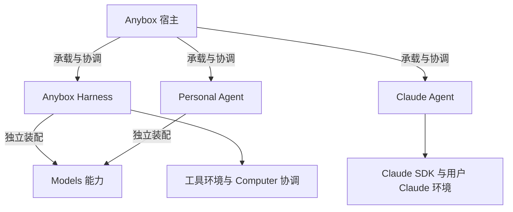
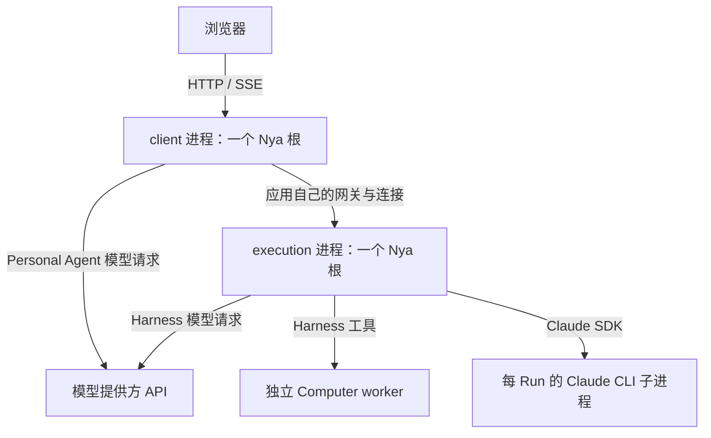
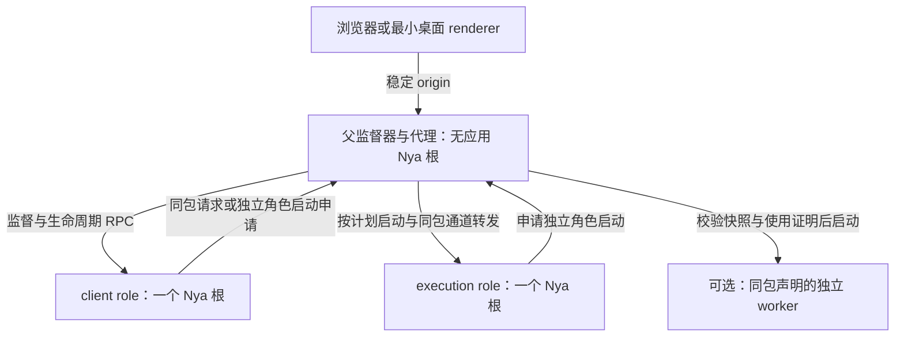

# Anybox 的逻辑架构、代码组织与运行时架构

Anybox 可以从三个角度理解：逻辑架构说明职责与所有权，代码组织架构说明源码与依赖边界，运行时架构说明实际实例、进程、通信和生命周期。三者描述同一个系统，不是一一对应的三个分层。

核对日期为 2026-11-16。本文依据 AnyboxV2 当前工作树的源码静态阅读，基线提交为 `2f84a73b8aab7d708e4b3dcb916586ee9b63ba53`，核对时包含尚未提交的修改。该提交在核对时无法从公开 GitHub 远端查询到，因此源码证据使用项目内相对位置和当时的行号，仓库链接仅作为项目入口。本文不是完整工作树归档，也没有重新启动服务、执行构建、运行测试或完成平台验收。

## 三种视图分别回答什么

| 视图 | 主要问题 | Anybox 中的例子 |
| --- | --- | --- |
| 逻辑架构 | 谁负责什么？谁拥有状态、数据与资源？通过什么契约合作？ | 宿主管理应用生命周期；Harness 拥有 Session、Run 和工具执行协调；Claude Agent 拥有自己的线程、审批和 SDK 调用 |
| 代码组织架构 | 职责怎样落实为文件、模块、包、入口和依赖约束？ | `host`、三个 `app-*`、`models`、`computer-tools` 等 workspace 包 |
| 运行时架构 | 启动后有哪些实例和进程？如何通信、持有资源、取消和退出？ | client/execution 角色、Nya 根、独立 Computer worker、Claude SDK 子进程 |

“软件架构”适合作为统称。“程序架构”如果没有进一步定义，可能同时包含上述内容，不适合直接作为与源码、运行时并列的第三类。

## 逻辑架构：宿主、应用与能力各自负责什么

### Anybox 宿主负责承载和生命周期

宿主承担应用目录与注册、应用运行目标、活动保护、HTTP 分派、浏览器外壳，以及应用包安装、生效、卸载和代码回收。具体业务由应用拥有。

其中有几个不同的职责：

- **Application Catalog**：校验注册声明、静态资源和路由，形成不可变目录。注册声明本身不等于业务已经打开。
- **Products**：保存应用的期望启停目标，并通过应用 runtime 执行 `open/stop/retry`，报告实际状态。同一应用的控制串行，不同应用可以独立推进。
- **Activity 与 guard**：登记活动和退出保护，冻结准入，并在需要时等待观察资源退出。忙碌或退出未知不能直接视为已停止。
- **Package Management**：分别保存安装事实、版本选择、待生效版本、确切快照使用和实际角色 ready 回执，并协调准备子进程、角色交接和回收。
- **Web Shell**：管理应用入口、路由、界面挂载和关闭；应用提供 `mount/setActive/canClose/dispose`。

这些事实不能合并成一个“应用是否打开”的布尔值：**安装、版本选择、生效、后台运行目标和界面挂载各有生命周期**。页面关闭与后台停止也不是同一个动作。

源码入口见 注册与惰性 runtime（`packages/host/src/applications/registration.ts:103`）、Products（`packages/host/src/applications/component.ts:21`）、包管理事实契约（`packages/host/src/package-management/port.ts:18`）。

### 当前有三个具体应用

当前默认客户端目录已经包含 Anybox Harness、Claude Agent 和 Personal Agent，不能继续按早期“两个应用”的描述理解整个系统。

这张图只表示逻辑承载和能力使用，不表示实例共享或进程数量：



图中的 Models 是可复用能力的名称。Harness 与 Personal Agent 使用各自的实例、配置和凭据归属，不代表共同连接到一个 Models 服务。

| 应用 | 自己拥有的主要业务 | 当前执行方式 |
| --- | --- | --- |
| Anybox Harness，稳定 ID `agent` | Agent 配置、Projects、Session 对话树、Run、Prompt、模型执行协调、工具环境、Computer 附着与操作事实 | 进程内协议 Loop 与 Models execution 往返；Computer 工具可以交给独立 worker |
| Claude Agent，稳定 ID `claude-agent` | 原生线程映射、Run、审批、追加输入、附件、原生会话与 MCP 等交互 | 本应用的 SDK 适配器驱动用户已安装并登录的 Claude 环境；每个 Run 有自己的 CLI 子进程 |
| Personal Agent，稳定 ID `personal-agent` | Agent、Work、Run、Artifact，以及对话、任务和成果管理 | 在 client 角色中直接使用自己的 `models.generateText()`；当前每 Run 为一次完整文本生成 |

Claude Agent 不复用 Harness 的 Session、RunRuntime、Models 或 Computer 工具系统。Personal Agent 虽然也使用 Run 这个业务名词，但拥有自己的实现与持久记录；其委派当前创建关联 Work，不会自动启动一个下游执行系统，也没有因此获得工具循环、终端或跨设备执行。

依据见 默认客户端应用目录（`packages/distribution/src/entrypoints/client-main.ts:42`）、Claude 业务装配（`packages/app-claude-agent/src/server-runtime.ts:20`）、Personal Agent 执行（`packages/app-personal-agent/src/core/component.ts:78`）。

### Harness 内部按职责协作

Harness 的逻辑架构可以围绕一次 Run 理解：

| 职责 | 核心责任 | 关键边界 |
| --- | --- | --- |
| Agent 定义 | 启动时校验的 instructions、默认模型与环境选择 | 是只读配置，不是独立 Nya 组件或进程 |
| Projects、Prompt、图片与文件快照 | 提供目录身份、提示词和固定输入资源 | 项目可以绑定本机或远端 Computer；项目不是 Context |
| Session | 会话、节点、全部 Run 记录、事件、原生恢复事实和固定工具声明 | 对外查询与执行方写入使用不同服务端口，底层仍由 Session 统一拥有 |
| Run | 幂等、准入检查、准备 program、耐久接受与移交 | 不解释具体模型协议的停止语义 |
| Protocol program / Loop | 解释各协议原生响应，决定继续模型交换、调用工具或结束 | 每个协议有自己的 Loop；不是独立服务进程 |
| RunRuntime | 持有 program、在途句柄和环境 scope，记账、取消、等待退出并结算 | 通过 `RunHost` 操作契约与 Loop 协作 |
| Models | 配置、凭据接入、协议驱动和私有 execution | 可变原生上下文与执行期凭据留在私有 execution；长期密钥由系统 Vault 保管，可恢复事实交给受信持久层 |
| 工具环境与 Computer 协调 | 将固定工具声明绑定到实际执行能力，保存与路由操作 | 环境目录是声明和绑定机制；真正的资源由组件或 scope 持有 |
| Computer worker | 接纳并执行设备工具、持有进程 scope、记录执行事实 | 有独立根和独立存储，不归客户端观察连接所有 |

简化执行顺序是：Run 检查并准备 → Session 事务接受 → RunRuntime 同步接管 program → Loop 进行模型与工具往返 → 等待实际退出与清理 → Session 原子结算。业务结果返回与资源实际退出是两件事，`result` 不能代替 `done`；清理失败不能创建成功节点。

更完整的运行和恢复机制见 [Anybox Harness 运行时架构](Anybox%20Harness%20运行时架构.md)。源码可从 核心装配（`packages/app-harness/src/core/index.ts:113`）、Run 准入（`packages/app-harness/src/core/run/component.ts:163`）、RunRuntime（`packages/app-harness/src/core/run/runtime-component.ts:59`） 进入。

## 代码组织架构：十二个 workspace 包

源码采用 npm workspaces 单仓。当前构建脚本列出十二个包：

| 组别 | 包目录 | 源码责任 |
| --- | --- | --- |
| 接入契约 | `packages/application-api` | 应用定义、Products/Activity、运行时、HTTP、Web 和 Nya 接入契约；按核心、`/node`、`/web`、`/nya` 等入口区分环境 |
| 宿主 | `packages/host` | 通用客户端/执行宿主、应用生命周期、包管理、HTTP、浏览器外壳与最小桌面 |
| 发行组合 | `packages/distribution` | 默认应用目录、组合工厂、CLI、环境配置、桌面与各角色入口 |
| 应用 | `packages/app-harness` | Harness 业务、服务端、客户端、浏览器，以及 Computer worker 入口、装配与协调 |
| 应用 | `packages/app-claude-agent` | Claude Agent 自有业务、SDK 适配、服务端、客户端与浏览器 |
| 应用 | `packages/app-personal-agent` | Personal Agent 自有业务、Models 装配、HTTP 与浏览器 |
| 模型能力 | `packages/models` | 通用模型配置、存储端口、Vault、目录、原生协议与 execution |
| 工具契约 | `packages/tool-api` | 无 Harness、Models、Nya 依赖的通用工具契约 |
| 工具实现 | `packages/computer-tools` | Bash、Apply Patch、Processes、Files 组件、来源契约与原生后端 |
| 基础提供方 | `packages/storage-sqlite` | SQLite 端口与独占存储实现；各业务组件登记自己的迁移 |
| 基础提供方 | `packages/api-key-manager` | 系统凭据适配，供连接和 worker 附着等消费者使用 |
| 基础提供方 | `packages/directory-picker` | 可选的本机系统目录选择能力 |

根构建脚本按手工列出的生产包依赖顺序逐包构建，默认还验证浏览器资源图；**构建顺序不是进程启动顺序**。十二个源码包也不等于十二个部署服务。依据见 workspace 构建脚本（`scripts/build-workspaces.mjs:6`）。

### 依赖方向表达产品边界

以下箭头表示本仓库主要生产代码依赖，省略第三方库、peer dependency 和部分基础包：

```text
distribution → host + 三个具体应用 + 组合所需基础提供方
host → application-api + storage-sqlite
app-harness → application-api + 基础提供方 + models + tool-api + computer-tools
app-claude-agent → application-api + 基础提供方 + Claude Agent SDK
app-personal-agent → application-api + storage-sqlite + models
computer-tools → tool-api
```

这里最有意义的约束是：host 的生产依赖没有具体应用；应用不通过 host 内部实现取得业务能力，也不互相导入。默认组合在 distribution 中完成，所以“宿主能承载 Harness”不要求“宿主静态依赖 Harness”。

Models 和 Computer 工具独立成包，表达它们可以独立开发和被其他消费者复用，不意味着必须拆成网络服务。相反，代码因复用而提取，也不自动获得“宿主核心”的职责。

`@nya/core` 来自独立的 NyaCore 仓库，资源组件通过公共入口消费它。它提供依赖就绪与生命周期框架，不是 Anybox 内另一个业务服务。当前多数包还导出 `./*` 子路径，公开入口不等于已经实施严格的源码封装或安全隔离。

依赖可核对各包 `package.json`，尤其是 host（`packages/host/package.json:32`） 与 distribution（`packages/distribution/package.json:25`）。

### 应用内部继续按归属组织

Harness 的 `src/core/` 保存领域函数、组件和运行机制，`src/http/` 是业务 HTTP，`src/client/` 拥有客户端连接与代理，`src/web/` 是浏览器实现；服务端、CLI 和注册入口位于应用包内。Claude Agent 和 Personal Agent 也拥有自己的注册与浏览器实现，目录细节随实际职责而不同。

宿主浏览器外壳位于 `packages/host/src/web/`。应用的浏览器代码与 HTML、CSS、图标等资源留在应用包中，不能把整个仓库理解为一个统一前端加一个统一后端。

客户端入口与服务端入口分开也有实际作用：加载 Harness 客户端注册不需要顺带导入 Models、协议 Loop 和服务端业务。

## 运行时架构：同一份代码可以采用不同拓扑

### 默认组合发行保留多种运行形态

| 入口或形态 | 进程与应用根 | 实际装配 |
| --- | --- | --- |
| 默认 `client` | 一个 Node 服务进程、一个 Nya 根 | 宿主外壳、Harness 客户端、Claude 客户端、Personal Agent |
| 默认 `harness-server` | 一个 Node 服务进程、一个 Nya 根 | 通用 execution host，注册 Harness 与 Claude Agent 的服务端；业务按后台目标打开 |
| `web:local` | 服务侧一个 Node 进程、一个 Nya 根 | 同根组合 client 与 execution，保留各自数据库、目标与资源身份；worker 另计 |
| 默认完整桌面 | Electron main、renderer、client utility process，以及按需启动的 execution utility process | client 与 execution 各自有根；main 负责进程和私有 RPC；execution 可由 `--local` 等方式预启 |
| 应用自带的 standalone server | 一个应用服务进程、一个 Nya 根 | Harness 与 Claude Agent 均有自己的独立服务入口，不要求加载默认完整组合 |
| `npm run personal-agent` | 一个仅装 Personal Agent 的客户端宿主进程 | distribution 创建 client host 并打开该应用；不是应用自带的独立无头业务服务 |

“客户端”在这里是运行角色名，不能推断其中只有代理。Personal Agent 的业务与模型调用就在 client 根内；Harness 与 Claude Agent 的客户端则分别管理连接和业务转发。

把默认 client 与默认 execution 分开部署时，可以画成下面的图。箭头表示主要调用，角色的启动由相应入口或桌面管理者负责。worker 与 Claude CLI 子进程表示可选执行路径，不是 server 启动后必然立即存在；worker 也可以是已经运行并被附着的独立实例：



execution 根内的 Models、Session、Run、RunRuntime 等通过 Nya 服务和函数协作，不各自启动 HTTP 服务。Claude Agent 的 Store、SDK 适配和 Runs 也属于其应用装配；CLI 子进程才是另一条执行边界。

`web:local` 则把图中的 C 与 E 合并到**同一个进程、同一个 Nya 根**。组合工厂通过 `serviceBindings` 为 execution 的存储、Products、Activity 和 Models 绑定不同服务身份，防止与客户端侧资源重名；这不是新 Context 或安全沙箱。当前本机代理仍使用 HTTP 端点与配对，共进程不等于共用一个监听器。

实际入口见 本地同根组合（`packages/distribution/src/composition/local-web.ts:14`）、默认 execution 组合（`packages/distribution/src/composition/harness-server.ts:24`）、Personal Agent 专用启动入口（`packages/distribution/src/entrypoints/personal-agent-main.ts:14`）。通信细节见 [HTTP 通信与部署入口](HTTP%20通信与部署入口.md)。

### 最小安装宿主采用受管角色路径

最小 `anybox-host serve` 与默认静态组合不是同一条启动路径。它使用父监督器、固定 role bootstrap、已安装快照和稳定 origin 代理：



- 父监督器不打开注册库、应用业务库或应用 Nya 根，持有进程句柄、生命周期 RPC、稳定代理和包使用锚。
- client role 独占注册库，装配 installer、activation、外壳与固定快照中的 client entries。
- execution role 按计划加载确切安装快照；没有 execution 条目时不启动该角色。
- 一个角色进程可以装配多个应用，当前不是每个应用单独一个进程。
- 同包私有通道固定 appId、确切包身份与使用代，传递应用自定义 JSON；宿主不解释其中的业务协议。
- 同包声明的独立 worker 经受控端口启动并持有使用证明；成功交接后有独立生命周期。

当前正式安装包的独立角色启动端口仍拒绝 Electron 和 Windows 运行时；最小 Electron 能启动 client/execution 角色，不代表它已支持这一独立 worker 启动路径。

正式安装的 Claude Agent 本机客户端与执行端使用该同包通道；远端仍使用应用自己的连接和 HTTP 代理。旧默认完整组合保留本机配对路径，不能把正式安装能力写成所有旧入口已经迁入。

最小 Electron 宿主复用同一监督机制，用 utility process 适配角色启动。这里“一个进程一个根”应准确理解为：**一个承载应用服务的角色进程有一个应用根**。父监督器、Electron main 与浏览器 renderer 不因此各自建立应用 Nya 根。

依据见 受管父监督器（`packages/host/src/package-management/managed-process.ts:84`）、role 装配（`packages/host/src/package-management/role-process.ts:62`）、同包通道契约（`packages/application-api/src/node.ts:5`）。

### Computer worker 是实际独立的执行与存储边界

worker 在自己的进程和 Nya 根内装配独占 `worker.sqlite`、图片资源、执行器、附着管理、拨出传输，以及 `computer-tools` 中的 Bash、Apply Patch、Processes、Files 组件。它接受并校验固定的 `WorkspaceBinding`，其中包含项目路径与身份，不另外装配服务端的 Projects 组件。

Harness 服务端拥有项目绑定、Computer 协调和操作记录；worker 拥有设备侧接纳、权限、真实执行句柄和执行事实，两侧账本不合并为一个数据库。

- 本机 worker 通过私有回环 HTTP 访问，观察客户端清理只关闭观察，不停止已经交接的 worker。
- 远端 worker 主动通过 HTTPS 拨出，长轮询领取请求并回传事实。
- 本机和多个远端环境可以同时存在，项目明确绑定某个 Computer 附着；不是整个 server 全局选择 local 或 remote。
- 当前 Models 执行仍在 harness server 进程内，没有因为登记了 Models 单元身份就出现远端 Models 服务。

Run 结束需要清理它拥有的工具调用和进程 scope，但空闲 worker 服务本身可以继续运行。关闭客户端也不会自动取消远端已接受的 Run。

依据见 worker 装配（`packages/app-harness/src/core/computer/worker-server.ts:39`） 与 按附着路由（`packages/app-harness/src/core/computer/worker-router.ts:81`）。

## 三种视图怎样对应

| 逻辑职责 | 主要源码位置 | 当前运行时落点 |
| --- | --- | --- |
| 应用启停、活动和退出保护 | `host/src/applications/`，契约在 `application-api` | client 与 execution 装配各自的 Products/Activity；本地同根组合使用不同服务绑定 |
| 安装、生效与代码回收 | `host/src/package-management/` | 管理 client 根、准备子进程、父监督器和实际角色共同参与，不是一个单独 installer 进程包办 |
| 应用界面生命周期 | `host/src/web/` 与各 `app-*/src/web/` | 浏览器或 Electron renderer 中的挂载实例；没有 Nya 根 |
| Harness 会话与执行协调 | `app-harness/src/core/session/`、`run/`、`protocol-agents/` | 同一 execution 根内的组件、闭包和每 Run 的 program |
| 通用模型能力 | `models`，装配在各应用入口 | Harness execution 根与 Personal Agent client 根分别拥有实例；本地同根组合也保持资源身份分离 |
| 工具契约、选择与执行 | `tool-api`、`computer-tools`、Harness 的 `tool-environments/` 与 `computer/` | 声明和协调在 Harness 根，Computer 工具资源在 worker 根；其他受信环境可以有自己的执行实现 |
| Claude 原生会话和任务 | `app-claude-agent` | 应用执行根中的组件，加 SDK 创建的 CLI/历史读取子进程 |
| Personal Agent 任务与成果 | `app-personal-agent` | client 根中的本应用组件、独立 Models 配置与 Vault 命名空间 |
| 默认产品组合与启动 | `distribution/src/composition/`、`entrypoints/` | 选择应用、配置与运行拓扑；不是另一个持有业务状态的领域组件 |

其中存在多对多关系：一个包可以导出多个组件并被多个角色消费；一个角色进程可以装配多个包和应用；一个逻辑执行链可以跨 server、worker 与外部模型 API。

数据边界也不等于包或进程边界。默认 client 的应用业务可以使用同一 SQLite 提供方但拥有不同迁移域；Harness 与 worker 使用不同连接和存储；Models 非秘密配置、系统 Vault 和运行期 execution 又有各自归属。判断所有权时，要继续查看端口、事务、锁和关闭入口，不能只看目录名。

### 用同一项改动检查三个视图

| 改动 | 逻辑视图 | 代码视图 | 运行时视图 |
| --- | --- | --- | --- |
| 把 Models 提取为独立包 | 模型职责可以保持不变 | 建立独立依赖、入口和复用边界 | 仍可安装在原来的 Nya 根内 |
| `web:local` 合并 client 与 execution | 两侧职责和数据归属仍保留 | 仍消费原来的 host 与应用包 | 从分角色进程变为同进程同根，显式绑定资源身份 |
| 将工具实现放入 `computer-tools` | 工具执行与 Harness 编排分离 | 通用工具包不依赖 Harness | 真实工具组件仍装配在 worker 根 |
| 新增 Personal Agent 应用 | 新增自己的任务、执行与成果模型 | 新增应用包和注册入口 | 当前在 client 根内执行，无需新增独立 server |
| 更新已安装应用版本 | 业务职责可能完全不变 | 安装新不可变产物 | 需要 guard、页面 dispose、确切快照与角色交接，不只是替换目录 |

一项改动可能同时影响三种视图。分类的价值在于分别说明职责、实现依赖和执行事实，而不是要求每次改动只能属于其中一种。

## 当前实现的解释边界

源码已经体现轻量宿主、独立应用、可安装目录/归档、正式角色加载、生效与卸载回收等结构；默认完整发行仍有静态应用组合。不能把源码拆包、最小宿主存在和默认产品整体完成按需下载发行视为同一个进度。

当前核对没有确认在线下载和旧默认发行整体迁入已经完成，也没有对新的运行拓扑做真实测试。包管理准备、独立角色启动与各应用工具还有各自的平台条件，某个工具支持 Windows 不代表所有宿主包管理路径也已经通过 Windows 验收。

本文采用的“逻辑架构、代码组织架构、运行时架构”是组织解释的视图，不是代码中的三个顶层模块。要了解某台机器实际运行了什么，还需要检查所用入口、配置、已安装快照、Products 目标、角色 ready 回执和实际进程；本文没有读取用户部署状态。

## 参考与关联

- [AnyboxV2 公开仓库](https://github.com/fanfan-de/AnyboxV2)：项目入口，远端内容不代表本次核对工作树的完整快照。
- 应用包设计（项目内 `docs/application-packages-design.md`）：设计与阶段背景，当前实现仍以源码核对为准。
- [Anybox 项目入口](README.md)。
- [Anybox Harness 运行时架构](Anybox%20Harness%20运行时架构.md)：Run、Loop、Models、工具环境、清理和恢复细节。
- [HTTP 通信与部署入口](HTTP%20通信与部署入口.md)：监听器、代理、本机 worker 与远端拨出的通信边界。
