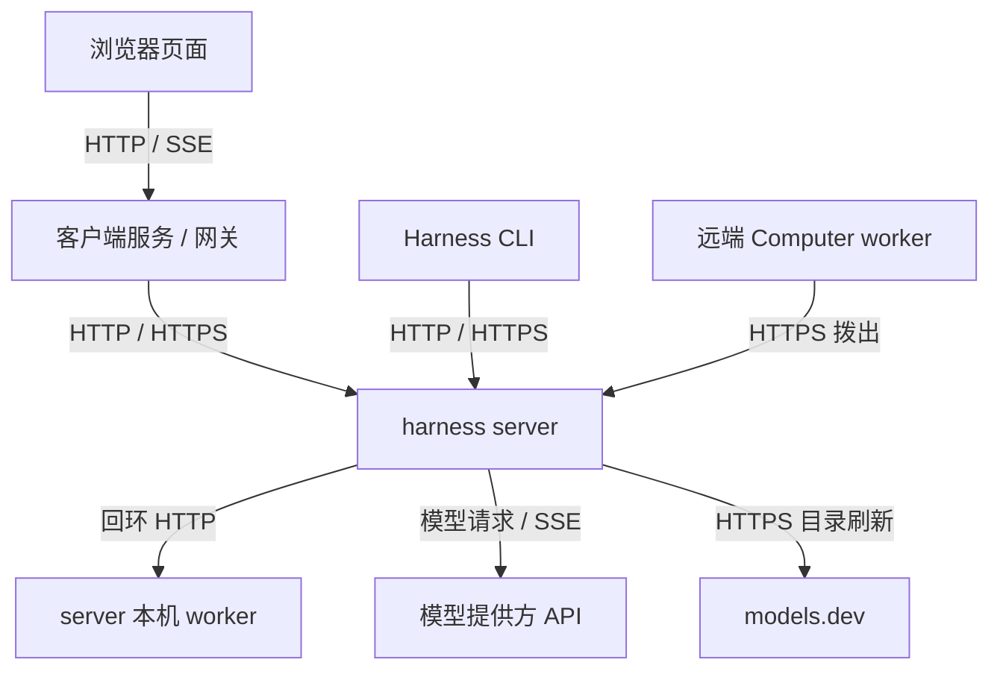
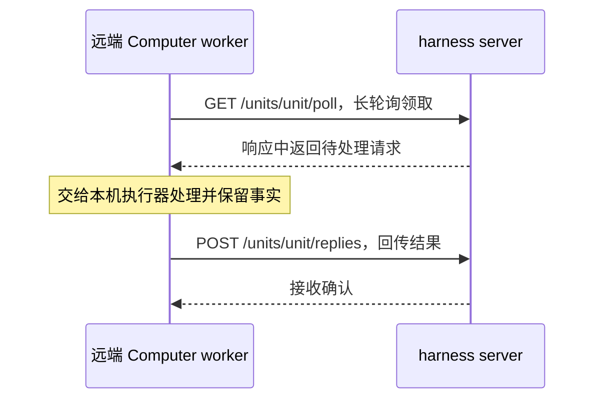
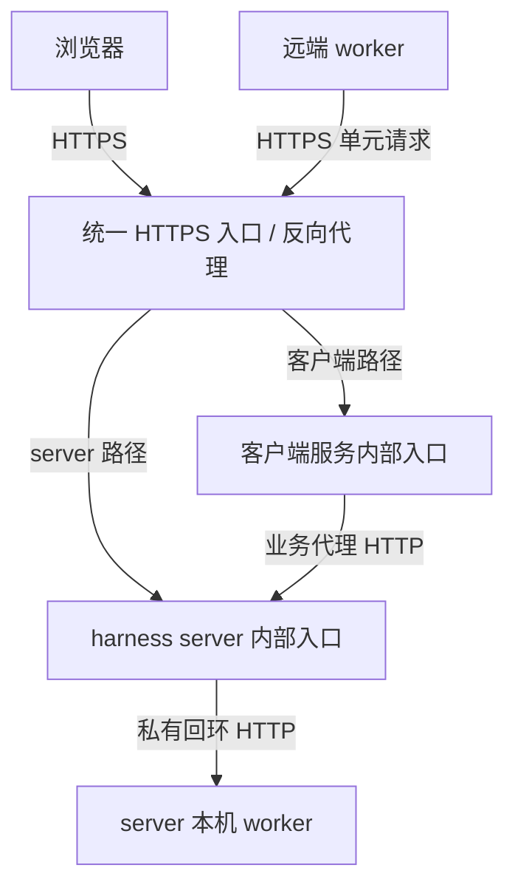

# Anybox 的 HTTP 通信与部署入口

本文说明 Anybox Harness 中哪些边界通过 HTTP 连接，以及为什么多条调用链路不需要同样多的 host 地址。核对日期为 2026-11-16，属于当前实现的静态梳理；统一公网入口的示例是部署建议，未在本文完成部署验证。

整体组件关系见 [Anybox Harness 运行时架构](Anybox%20Harness%20运行时架构.md)。

## 调用链路、监听器与地址

HTTP 调用链路数量不等于 HTTP 服务端监听器数量。浏览器、CLI、模型驱动和目录来源都可以主动发出请求，不会因为每增加一种请求就增加一个本地监听器。

| 概念 | 含义 | 示例 |
| --- | --- | --- |
| host | 目标主机名或 IP | `anybox.example.com`、`127.0.0.1` |
| 端口 | 主机上的某个网络监听入口 | HTTPS 常用 `443`；私有服务可以使用其他端口 |
| 路径 | 同一入口内分派不同请求 | `/api/v1/apps/agent/sessions` |
| origin | 协议、host 和有效端口的组合 | `https://anybox.example.com` |

一个监听器可以按路径处理许多接口。同一个 host 可以有多个端口；一个公开 origin 也可以通过入口代理分发到多个内部监听器。本文使用的域名是示意占位符。

这里的 HTTP 链路包含 HTTPS。SSE 和长轮询都是基于 HTTP 的通信方式，不额外代表一种服务。

## 当前 HTTP 链路

图中箭头表示 HTTP 请求的发起方向，响应沿原连接返回。每个框代表一个角色或外部服务；客户端服务与 server 在 `web:local` 下可以同进程，图示不要求它们始终分进程部署。



远端 worker 箭头朝向 server，是因为连接由 worker 主动发起；工具请求随长轮询响应返回，详见后面的时序图。本图聚焦 server 的主要通信链路，客户端对其所在设备 worker 的独立管理列在下表。

| 调用方 → 接收方 | 实际方式 | 用途 |
| --- | --- | --- |
| 浏览器页面 → 客户端服务 | HTTP，请求 JSON、上传和 SSE 观察 | 界面操作、连接管理和业务请求 |
| 客户端网关 → harness server | HTTP / HTTPS，请求与响应流转发 | 固定所选连接、凭据和实例身份后代理业务 |
| Harness CLI → harness server | HTTP / HTTPS，JSON 与 SSE | 直接管理项目、Session、Run、模型等 |
| harness server → 本机 Computer worker | 私有回环 HTTP，JSON | 工具接纳、提交、原结果查询与设备查询 |
| 客户端管理组件或 worker CLI → 本机 worker | 同一个私有回环 HTTP 入口 | 状态、附着、权限、撤销和显式停止 |
| 远端 Computer worker → harness server | 主动 HTTPS 长轮询、JSON POST 和字节上传 | 领取请求并回传执行事实与图片 |
| Models 协议驱动 → 模型提供方 API | HTTP / HTTPS，JSON 或 SSE | 四种原生协议的模型交换 |
| Models 目录来源 → models.dev | HTTPS，JSON | 刷新公开目录，执行不依赖实时刷新 |

## 客户端、server 与本机 worker

浏览器通常先访问客户端服务，由网关使用所选连接的凭据访问 server。CLI 可以直接访问 server。网关转发包括 JSON、上传、图片和 SSE；浏览器不持有本机 worker 的私有 token。

harness server 的 Session、Run、Models 等业务共用 HTTP 入口，例如：

```text
/api/v1/apps/agent/sessions
/api/v1/apps/agent/runs/...
/api/v1/apps/agent/models
/api/v1/apps/agent/units/unit/poll
```

server 内部的 Session、Run、RunRuntime、协议绑定和 Models execution 通过 Nya 服务与函数调用协作，不会各开一个 HTTP 端口。Models 是进程内组件群，驱动请求外部模型 API 时才跨越 HTTP 边界。

本机 worker 是独立进程，在 `127.0.0.1` 动态端口提供带私有 token 的 HTTP 服务。server 或本机管理客户端通过该入口调用，例如：

```text
POST /info                    查询 worker 身份与能力
POST /claim                   声明 Run 执行归属
POST /submit                  提交工具操作
POST /get                     查询原操作结果
POST /query                   查询目录或读取文件
POST /attachments/permissions 修改附着权限
POST /shutdown                显式停止 worker
```

因此，同机分角色运行时主要关注客户端服务、harness server、worker 的少量监听入口。worker 的回环端口不需要暴露为公网入口。启动 worker 进程由进程启动机制完成，启动后的业务通信使用 HTTP。

`web:local` 将客户端和 server 合并到同一个 Node.js 进程及 Nya 根，但当前业务代理仍经 HTTP。共进程、共根与共用一个 HTTP 端口是不同事实，不能相互推断。

## 远端 worker 主动拨出

远端 worker 主动连接 harness server，server 将请求放入传输邮箱，worker 长轮询领取，执行后 POST 回执：



图中路径前缀为 `/api/v1/apps/agent`。附着还使用 `attach`，图片传输使用 `bytes`。远端要求 HTTPS，仅回环允许明文 HTTP。这些单元请求直接访问 server，不经过客户端网关。

这种方向允许 worker 只需能够向外连接 server，而不要求 server 主动访问 worker 的公网地址。连接断开不等于工具未执行，重连与结果查询仍沿固定操作身份，不能仅因 HTTP 超时重新执行副作用。

## SSE 与普通查询

当前变更和协议展示推送流使用 `/api/v1/changes`，响应类型为 `text/event-stream`；客户端可以代理该流。`/runs/:id/events` 是普通 JSON 事件查询。模型 API 的流式响应是另一条独立 HTTP 链路，两者都可以使用 SSE，但有各自的状态与生命周期。

HTTP 观察取消也不自动证明远端资源已经退出。Run 的结束仍要遵守业务结果、取消与实际退出的契约，见 [运行时架构](Anybox%20Harness%20运行时架构.md)。

## 一个公开入口的部署示意

下面是一种可采用的部署方式，不代表所有启动组合都已经如此配置：



入口的多条路径汇入同一组内部监听器。下面列出用于分派的路径示例，worker 的回环接口不经过公网入口：

```text
https://anybox.example.com
  /api/client/v1/...                    → 客户端服务
  /api/connections/...                 → 客户端连接网关
  /api/v1/apps/agent/...                → harness server
  /api/v1/changes                       → server 的 SSE 变更流
```

入口代理按路径转发到内部监听器，并正确处理流式响应、上传和连接超时。worker 的本机回环入口留在设备内部，远端 worker 通过同一个公开 server 入口拨出。

这个示意说明一个 host、一个公开 HTTPS 端口可以承载多种接口；实际路由、认证、静态资源与兼容路径仍需按选定启动组合配置和验证。接口数量本身不要求增加 host 地址。

## 依据与验证范围

项目内的主要核对入口：

- `packages/app-harness/src/client/` 下的 `gateway.ts`、`connection-proxy.ts`：浏览器请求接收与 HTTP 上游转发。
- `packages/app-harness/src/cli/http.ts`：CLI 的直接 HTTP 调用。
- `packages/app-harness/src/core/computer/` 下的 `worker-client.ts`、`worker-server.ts`：回环端点与本机请求。
- 同目录的 `worker-dialout.ts`、`worker-attachments-domain.ts`：长轮询、回执、路径和 HTTPS 条件。
- `packages/app-harness/src/http/` 下的 `handler.ts`、`run-change-stream.ts`：JSON 查询与 SSE。
- `packages/models/src/` 下的 `protocols/transport.ts`、`catalog-source.ts`：模型 API 和目录请求。
- `packages/distribution/src/composition/local-web.ts`：本机同进程组合仍将 server URL 交给客户端连接。

本次整理未启动服务、测量端口、配置反向代理或验证公网连通性。统一入口中的 SSE、上传、认证与超时行为需要实际部署验收。

[Anybox 项目入口](README.md) · [Anybox Harness 运行时架构](Anybox%20Harness%20运行时架构.md)
