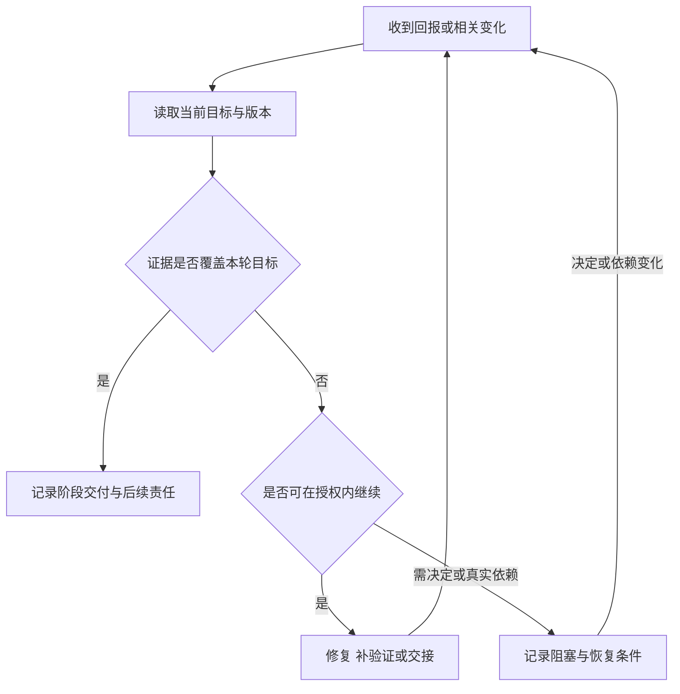

# AI 原生团队的内部研发协作：Claude、Manus 与脱手循环

调研日期：**2026-11-17**。研究对象是组织怎样用 AI 研发自己的软件，重点为 Anthropic 的 Claude Code 相关团队和 Manus，补充 OpenAI 的内部研发案例。本文为“构建脱手循环”设计中的“发出 → 接手 → 自主执行 → 回报 → 继续推进”提出规则建议。

**主要判断〔B〕：值得借鉴的是可检验的委托、可接续的上下文和明确的例外处理。公开证据支持扩大 Agent 的自主执行范围，但没有证明某一种组织结构能够普遍消除人工协调。** Claude Code 的审查与验证复盘、Manus 的组织复盘和 OpenAI 的 Symphony 案例分别提供了不同层面的证据。[Claude Code 审查](https://claude.dev/blog/solving-code-review-at-anthropic/)、[Manus 内部复盘](https://manus.im/blog/rebuilding-manus-with-manus)、[Symphony 内部应用](https://openai.com/index/open-source-codex-orchestration-symphony/)

## 1. 阅读边界与证据标记

- **A：来源直接描述的实践。** 仍需区分工程师个人、特定团队、组织级自述和受控实验。一手自述不等于独立审计，也不等于已公开完整实施细节。
- **B：综合推断。** 说明依据及不能推出的结论。
- **C：针对本方案的建议。** 不写成这些公司已经采用的规则，也不写成本方案已经验证的能力。

主资料为作者本人、组织官网、直接采访和会议主办方发布的讲者材料。播客只使用原节目制作方的摘要与时间轴，未声称完整听看；会议简介只证明讲者公开作了相应陈述，不等于完整演讲实录。网页发布日期、实际观察时间与页面更新时间分别记录。

产品文档、功能公告、产品 Agent 的推理架构，只能证明所写的能力或设计。若同一文章同时包含内部实践和产品介绍，只采纳明确说“我们内部如何使用”的段落。资料中没有公开的事项，一律写为本次检索未取得证据。

本文没有部署 webhook、运行这些公司的私有系统或修改现有中立 Agent Skill。后文规则均是待评审建议。

## 2. 精选资料：按用途阅读

### Claude／Anthropic

| 编号与直接来源 | 作者、日期、适用范围 | 能回答什么；阅读限制 |
| --- | --- | --- |
| A1 [Running an AI-native engineering org](https://claude.com/resources/articles/running-an-ai-native-engineering-org) | Fiona Fung，Claude Code／Cowork 工程负责人；2026-06-03；相关工程团队。 | 规划、角色、团队共同原则与小组自由；重点看 Planning、Code review、How we rolled out。不能外推研究、训练等所有部门。 |
| A2 [How the Claude Code team does code review](https://claude.dev/blog/solving-code-review-at-anthropic/) | Addy Osmani、Morgan Westlee Lunt、Qing Wang；2026-10-15；Claude Code 相关仓库。 | 审查到发布的主资料；重点看 Layer by layer、How we make the reviewer better。风险分级有适用条件。 |
| A3 [How the Claude Code team thinks about verification](https://claude.dev/blog/how-the-claude-code-team-thinks-about-verification/) | Addy Osmani；2026-11-16；主要为 Claude Code 团队，个别段落谈 Anthropic。 | 最新验证与规则改进；重点看同名内部实践章节。作者建议与已实施措施须分别阅读。 |
| A4 [Lessons from building Claude Code: How we use skills](https://claude.dev/blog/lessons-from-building-claude-code-how-we-use-skills/) | Thariq Shihipar，Claude Code 技术成员；2026-06-03；内部 Skills 使用经验。 | 方法如何沉淀、分发与衡量；Management／Measuring 部分最贴题。文中类别示例不能逐项视为已部署的内部实现。 |
| A5 [Introducing Claude Tag](https://www.anthropic.com/news/introducing-claude-tag) | Anthropic 官方，未署个人作者；2026-06-23；公司及产品团队使用自述。 | 核实内部确实使用 Slack 委托。只采用内部使用段落，不把功能表当组织流程。 |
| A6 [Redesigning source control at Anthropic](https://www.anthropic.com/research/redesigning-source-control) | Anthropic Engineering，未署个人作者；2026-10-13，10-15 更新；公司大型 monorepo。 | 检查旧 Git 工作方式是否过时；不应把其基础设施选择套到 Claude Code 独立仓库。 |
| A7 [How AI is transforming work at Anthropic](https://www.anthropic.com/research/how-ai-is-transforming-work-at-anthropic) | Anthropic Societal Impacts；2025-12-02 发表，2025-08 调查；受访工程师与研究人员。 | 历史基线、委托判断与局限；132 份问卷、53 次访谈。不能作为 2026 年末的当前自主率。 |

### Manus

| 编号与直接来源 | 作者、日期、适用范围 | 能回答什么；阅读限制 |
| --- | --- | --- |
| M1 [Rebuilding Manus with Manus: What changed, what broke, and how we work now](https://manus.im/blog/rebuilding-manus-with-manus) | Tao Zhang，联合创始人／CPO；2026-10-30，页面元数据更新于 11-03；工程、产品等团队的内部复盘。 | 最重要的流程证据：§2–6 研发，§8 上下文，§10 仍未解决的问题。更新无修订日志，不能认定每段都在 11-03 改过；数字主要截至 10 月下旬。 |
| M2 [AI-Native Work at Manus: One Monorepo, Open Tasks](https://ai.engineer/shanghai/2026/speakers/fan-bin) | Fan Bin，Manus Agent Engineer Lead；AI Engineer Shanghai，2026-11-05 演讲；主办方刊载的讲者摘要。 | 共享工作区、规则、任务可见性与接手。是摘要级直接陈述；标题中的 Monorepo 需结合 M1 理解。 |
| M3 [找刚入职 Manus 的余一聊感受](https://www.xiaoyuzhoufm.com/episode/6ae1d8b397726cd4675926fa) | AI 炼金术，徐文浩／任鑫访谈余一；2026-10-28；新入职者观察与个人 Agent 用法。 | Slack 反馈处理的旁证，及个人 Bot 编排体验。定位 25:27、30:07；个人主 Agent 见 05:59、42:14。不能推广为研发组织政策。日期由原节目元数据核对。 |

### 补充对照：OpenAI

| 编号与直接来源 | 作者、日期、适用范围 | 能回答什么；阅读限制 |
| --- | --- | --- |
| O1 [Harness engineering: leveraging Codex in an agent-first world](https://openai.com/index/harness-engineering/) | Ryan Lopopolo；2026-02-11；一个内部产品团队，回顾约五个月。 | 可执行环境、仓库知识和 Agent 审查循环；从零构建的特定实验，虽有真实用户，也非全公司政策。 |
| O2 [An open-source spec for Codex orchestration: Symphony](https://openai.com/index/open-source-codex-orchestration-symphony/) | Alex Kotliarskyi、Victor Zhu、Zach Brock；2026-04-27；起点是 O1 团队，另报告部分团队应用。 | 最贴近持续跟进的内部案例：任务、执行恢复、依赖与交付材料。不能把部分团队结果推广到全部研发。 |
| O3 [Symphony 公开规范 v0.0.3](https://github.com/openai/symphony/blob/v0.0.3/SPEC.md) | OpenAI；读取日 2026-11-17；固定标签的服务规范，配套仓库有参考实现。 | 用于核对协调服务与任务策略的职责边界。规范描述不是内部部署验收报告，后文不据此新增组织事实。 |
| O4 [Inside OpenAI’s agentic software factory](https://newsletter.pragmaticengineer.com/p/openai-software-factory) | Gergely Orosz；2026-09-15；亲访七位工程人员，管线主要由 Applied Infra 工程负责人 Venkat Venkataramani 描述。 | 较新的一手采访；只读公开部分，第 3 节区分 PR 审查与生产批准，未使用付费部分。 |

推荐先读 **M1 → A2 → A3 → O2**，再读 A4 和 M2 补齐规则与共享上下文。

## 3. Claude 相关团队：能还原什么

### 3.1 需求、委托与人的位置〔A〕

Fiona 的团队从长周期预规划转向原型、内部使用反馈及 PR 讨论；PM 也写代码，工程师参与设计。团队保留少量共同原则，triage 和规划方式让各 pod 自行调整。人重点提供产品品味、系统与领域判断。这里没有证据表明所有需求都经过统一接单 Bot。[A1](https://claude.com/resources/articles/running-an-ai-native-engineering-org)

Anthropic 明确报告内部已通过 Slack 的 `@Claude` 委托工作，并并行委托多个 Claude。这足以证明实际使用了共享沟通入口；公告没有完整披露人员归属、个人身份映射及恢复协议。[A5](https://www.anthropic.com/news/introducing-claude-tag)

### 3.2 从实现到发布〔A〕

截至 2026-10 的 Claude Code 流程，可压缩为以下路径；它适用于相关仓库，不是全公司统一制度：

| 环节 | 已披露实践 |
| --- | --- |
| PR 前 | Agent 出示执行结果，并可由新上下文的子 Agent 审查。 |
| PR 审查 | AI 与安全审查、自动检查先行；发现项须修复或说明处置理由，可由 Agent 接续修复。 |
| 人工介入 | 可信作者的低／中／高风险路径分别可要求 0／1／2 个人批准；敏感路径等有额外限制。 |
| 合入及发布 | merge queue 对组合后的代码复测；通常先内部 feature flag，再 `latest`、后 `stable`。 |
| 后续 | 变更责任人和 on-call 继续负责问题；并未消除人工结果责任。 |

仓库共识用简短 `CLAUDE.md` 导航，代码所有者用 `REVIEW.md` 写审查重点。表中及本句事实来自 [A2 的 Layer by layer 与 Where humans stay in the loop](https://claude.dev/blog/solving-code-review-at-anthropic/)。不能省略可信作者、风险和门禁条件，只留下“零人工批准”。

### 3.3 验证、规则与改进〔A〕

11 月的补充披露：团队重视运行应用做端到端 smoke test，PR 前先跑本地测试、构建和 lint；验证对应具体 commit，检查由 code owner 维护，PR 不能改自己的门禁基准。检查失败先自修复，三轮仍失败则请人处理；新门禁可先观察误报。团队从重复审查意见与回退中提炼规则，经反证和人审；另回放事故 PR 寻找漏检。这是有边界的实践，三轮不等于适用于所有任务的自然常数。[A3](https://claude.dev/blog/how-the-claude-code-team-thinks-about-verification/)

Skills 的推广没有中央团队统一挑选：作者先在 sandbox 分享，经同事试用后提 PR 进入 marketplace，并统计实际触发。Skills 可带脚本与资源，经验从真实边界情况逐渐补入；作者强调验证类 Skills 的价值。这里支持“共同方法可复用”，并未规定每位员工必须使用同一套个人执行提示词。[A4](https://claude.dev/blog/lessons-from-building-claude-code-how-we-use-skills/)

### 3.4 时间变化与证据缺口

- **历史基线〔A〕：** 2025 年 8 月调查中，多数受访者称可完全委托的工作只占 0–20%，高频使用仍伴随监督。这与 2026 年后期更自主的个别团队流程不是同一时间、同一口径，不能直接画成增长曲线。[A7](https://www.anthropic.com/research/how-ai-is-transforming-work-at-anthropic)
- **仓库范围〔A〕：** 2026 年 10 月披露的大型 monorepo 已从 Git 迁至 Scion，并有 Antique 审查界面；Claude Code 则使用独立仓库。不能把两者拼成一个实现，也不能据此建议普通团队迁离 GitHub。[A6](https://www.anthropic.com/research/redesigning-source-control)、[A2](https://claude.dev/blog/solving-code-review-at-anthropic/)
- **尚缺证据：** 未取得全公司统一需求入口、每人一个常驻个人 Agent、全局中立 Bot 的动态选人算法、跨个人 Agent 接单回执、重复事件处理及重启恢复协议。
- **适用范围：** 这些资料能说明 Claude Code 产品研发，并不足以还原全部模型训练、研究、安全研究和基础设施团队的日常协作。

**综合判断〔B〕：** 已看到共享入口、个人会话、审查 Agent 和工程门禁共同工作；无法认定它们就是“一个中立人格管理每个人的专属 Bot”。更稳妥的映射是能力与责任，而非账号拓扑。[A5](https://www.anthropic.com/news/introducing-claude-tag)、[A2](https://claude.dev/blog/solving-code-review-at-anthropic/)

## 4. Manus：能还原什么

### 4.1 研发路径〔A〕

Tao Zhang 的复盘可还原两类入口：Slack 需求交给 Manus／Codex；用户报错先由只能调查回报、不能改代码的 Agent 定位变更并 `@` 负责人，工程师判断后交自己的 Agent。独立 Agent 验证修复，浏览器／移动模拟器执行用户流程，review bot 审代码。涉及模型调用或成本须先找负责人确认；合并与发布保留人工批准。[M1 §3–4](https://manus.im/blog/rebuilding-manus-with-manus)

Mono 是多仓统一入口，含系统说明与 ADR，并非物理合仓；使用 worktrees 并行、支持本地全栈验证。工程师的 Agent 可加入相关 Slack 讨论；成员把发布等经验沉淀进共享资料。[M1 §2、§4](https://manus.im/blog/rebuilding-manus-with-manus)

### 4.2 共享上下文、个人 Agent 与跟进〔A〕

Fan Bin 的演讲摘要补充：共享工作区包含仓库、团队规则和 Skills，工程、产品、设计、运营人员均可提 PR；团队任务彼此可见，知情人通过任务链接补充信息，其他成员可接续离开的同事。它证明公开协作的组织主张与做法，未给出并发接管实现。[M2](https://ai.engineer/shanghai/2026/speakers/fan-bin)

M1 的 §10 还明确说已有一个 Agent 监督其他 Agent，只汇报卡点与待人决策事项，同时承认方案仍基础。§5 记录了无人筛选反馈导致周末积压 200 多项待决事项的失败尝试。其监督者的身份、权限及完整派发协议没有披露。[M1](https://manus.im/blog/rebuilding-manus-with-manus)

余一的节目摘要提供了较弱但独立的旁证：她观察到 Slack 反馈会由 AI 定级、找处理人和查重复；她自己用主 Agent 调度多个 Bot。后一部分属于个人使用方式；移走旧 harness 重跑是当时的计划，不能写成 Manus 已完成的团队改造实验。[M3，30:07、42:14、54:08 附近的制作方摘要](https://www.xiaoyuzhoufm.com/episode/6ae1d8b397726cd4675926fa)

### 4.3 证据能支持到哪里

**综合判断〔B〕：** Manus 的公开实践与“共享协调能力＋个人执行 Agent＋共同上下文”更接近；但我们不能把“监督其他 Agent”进一步解释为已完成本方案的全部中立 Bot 协议。[M1](https://manus.im/blog/rebuilding-manus-with-manus)、[M2](https://ai.engineer/shanghai/2026/speakers/fan-bin)

需要保留的缺口：

- 未见可审计的 Mono 完整公开实现，以及生产使用的接单、取消、租约、重试和恢复状态模型。
- 工程师作承接判断的路径有明确证据；是否有其他路径允许共享协调 Agent 在预授权范围内直接分派个人 Bot，公开材料不足。
- M2 的“任务可接续”不能证明旧执行必然被停止，也不能证明多人同时修改不会冲突。
- 尚无完整的团队规则／个人偏好／本次指示冲突优先级，以及个人规则的版本与兼容性协议。
- M1 同时谈工程、产品、营销和个人用法。营销 Agent 的排队机制及尚在探索的功能，不自动成为工程团队已部署的规范。
- 不能把这份进行中的组织复盘当作长期质量、成本或无人值守可靠性的独立评估。

## 5. 补充对照：谁承担“继续推进”

### OpenAI 的两个公开时间点〔A〕

O1 的特定内部产品团队把环境、知识和反馈做成 Agent 可用的工程材料：每个 worktree 能启动应用，浏览器、日志和指标可供检查；简短 `AGENTS.md` 指向仓库里的详细知识。该案例有真实用户，但“零手写代码”是刻意设置的实验约束，不能当作其他团队的准入条件。[O1](https://openai.com/index/harness-engineering/)

O2 进一步把工作从交互会话转到 Linear 任务：任务对应独立工作区，协调服务恢复停滞执行，依据依赖安排工作，并跟进 CI、rebase 等收尾。PM／设计师也可发起任务，收到含实际产品演示的审阅材料。团队仍保留人处理模糊、需要强判断的工作。这是内部持续跟进的直接证据，不只是产品功能列表。[O2](https://openai.com/index/open-source-codex-orchestration-symphony/)

2026 年 9 月的直接采访补充了更新的基础设施管线：可以有按风险自动批准的 PR，但生产部署 Agent 的接续起点仍是人批准生产变更。不能从 PR 审查自动化推导发布也已无人决定。[O4 第 3 节](https://newsletter.pragmaticengineer.com/p/openai-software-factory)

**综合判断〔B〕：** 中立 Bot 的语义判断与宿主的运行保障应分清：前者决定下一步，后者使它有机会继续运行。一个写着“持续跟进”的 Skill，不能替代重启、计时、事件与动作状态。[O2](https://openai.com/index/open-source-codex-orchestration-symphony/)、[公开规范 O3](https://github.com/openai/symphony/blob/v0.0.3/SPEC.md)

### 没有纳入生产流程对比的材料

Cursor 的 [Scaling long-running autonomous coding](https://cursor.com/blog/scaling-agents)（Wilson Lin，2026-01-14）是并行长期编码实验；后续 [Towards self-driving codebases](https://cursor.com/blog/self-driving-codebases)（Wilson Lin，2026-02-05）仍定位为研究。可用于思考规划、执行和检验的分工，不能据此声称 Cursor 日常全部研发都如此运行。

Manus 的 [Context Engineering for AI Agents](https://manus.im/blog/Context-Engineering-for-AI-Agents-Lessons-from-Building-Manus)（Yichao Ji，2025-07-18）主要解释产品 Agent 的上下文设计。它不能证明 Manus 工程师内部如何接单、审查和交接。类似地，公开 Agent Skills 仓库或协作功能说明不自动证明组织采用率。

## 6. 对“脱手循环”最有价值的迁移判断〔B／C〕

本方案已有的设计是：任何人可提供材料或直接改动；GitHub Issue／PR 为共同上下文；中立 Bot 负责协调，各成员的个人 Grok Bot 在云电脑中调用 Codex CLI；个人保留执行方法自由。以下建议只针对这些选择，不要求换工具或重构平台。

| 可借鉴的原则〔B〕与依据 | 对当前方案的建议〔C〕 | 适用条件与不宜照搬之处 |
| --- | --- | --- |
| 自主执行需要能够判断是否完成。[A3](https://claude.dev/blog/how-the-claude-code-team-thinks-about-verification/)、[O1](https://openai.com/index/harness-engineering/) | 派发前整理“目标行为—验证办法—完成边界”，缺失由 Bot 调查补齐。 | UI 品味、商业选择不能全部变成程序断言；不要把“有测试”误当“需求正确”。 |
| 共享上下文可以跨个人接续。[M2](https://ai.engineer/shanghai/2026/speakers/fan-bin)、[O2](https://openai.com/index/open-source-codex-orchestration-symphony/) | Issue 保存有效目标和决定，PR 保存代码及检查，个人会话只是工作现场。 | 共享摘要需能追溯原材料；不要求公开私人提示词、凭据或所有会话。 |
| 方法自由与共同规则可以并存。[A1](https://claude.com/resources/articles/running-an-ai-native-engineering-org)、[A4](https://claude.dev/blog/lessons-from-building-claude-code-how-we-use-skills/) | 统一对外承诺及回报语义，个人规则决定内部调查、工具与方法。 | 能力声明必须可核对；自由不包括静默改变委托目标。 |
| 跟进是独立工作，不会随代码完成自动消失。[M1](https://manus.im/blog/rebuilding-manus-with-manus)、[O2](https://openai.com/index/open-source-codex-orchestration-symphony/) | 中立 Bot 对每次回报形成明确下一动作或等待条件。 | 不必固定“产品→程序员→测试”顺序；也不能把共享 Bot 的判断当后台调度能力。 |
| 人的参与由具体决策与风险决定。[A1](https://claude.com/resources/articles/running-an-ai-native-engineering-org)、[A2](https://claude.dev/blog/solving-code-review-at-anthropic/) | 先判断缺的是事实、执行能力还是人的选择，只把最后一类及真实边界冲突提交人。 | 不照搬零人工合入；本方案默认交付可审阅 PR，合并与发布另看实际授权。 |
| 审查自身也需要被验证。[A3](https://claude.dev/blog/how-the-claude-code-team-thinks-about-verification/)、[A4](https://claude.dev/blog/lessons-from-building-claude-code-how-we-use-skills/) | 记录误报、漏报和循环不收敛案例，再决定改规则、检查还是环境。 | 不因一次失误就给全员增加永久步骤；不把更多 Agent 的一致意见当独立事实。 |

不宜直接照搬的还有：大公司的专有源码系统、无限 token 投入、固定数量的并行会话、所有任务都走同一验证路径，以及模型升级后仍永久保留的旧规程。具体能节省多少人工注意力，应由本团队自己的执行记录判断。

## 7. 中立 Agent Skill 草案：已有基础与具体增量〔C〕

建议以本轮读取的中立协调指令 v0.1、委托与推进协议、配置与个人规则为基线。这些内容目前保留为本机设计草案，尚未公开，也未安装为运行中的 Skill。基线已经具备：有效触发判断、稳定委托关联、投递与接手区分、目标及代码版本核对、授权内修复、等待恢复、个人规则适配。

因此这次建议集中在补足判定依据与可核对承诺。**“可直接采用”只表示可写入协调行为规范，不表示运行环境已经具备该能力。** 本文不直接改 Skill。

### 7.1 可直接采用：增补或细化现有判定规则

| 位置 | 建议条款 | 与既有规范的关系及来源启发 |
| --- | --- | --- |
| 理解任务并选择下一步 | **验证先行。** 派发前，为本轮必需行为确定可取得的证据；区分代码静态检查、真实运行行为和人的体验判断。能自动查明的先查明。 | 从“说明验证要求”细化到证据类型；借鉴 [A3](https://claude.dev/blog/how-the-claude-code-team-thinks-about-verification/)。 |
| 理解任务并选择下一步 | **控制新工作的产生。** 执行中发现的范围外改进先关联到候选事项；只有原目标所必需且在授权内的修复才进入当前循环。 | 防止中立 Bot 自动扩张目标和待决队列；参考 [M1](https://manus.im/blog/rebuilding-manus-with-manus)，具体控制办法为本方案建议。 |
| 发出与接手 | **接手须确认所依据的版本。** 回执关联委托和输入版本；若与当前材料冲突，先重新核对受影响部分，再声明开始。 | 现有回执增加“接的是哪版工作”；是本方案协议补充，公开案例未给出同等协议。 |
| 自主跟进与回报核对 | **把行为和证据逐项对应。** 回报至少能回答：哪个场景、在哪个环境、针对哪个代码版本、结果是什么、证据在哪里。 | 不再依赖笼统“测试通过”；参考 [O2](https://openai.com/index/open-source-codex-orchestration-symphony/) 的交付材料思路。 |
| 自主跟进与回报核对 | **保留验证边界。** 截图、模拟接口、测试账号和真实业务结果分别说明覆盖范围；没有适用环境时返回“未验证”，不得替换为成功。 | 已有规则的可检查表达；不是要求每个任务都跑全套测试。 |
| 自主跟进与回报核对 | **修复须有新依据。** 下一轮说明观察到的失败、已排除或待验证的原因、这次改变及判定方法；区分真正代码缺陷、环境问题、偶发失败和审查分歧。 | 让重试按原因收敛；参考 [A3](https://claude.dev/blog/how-the-claude-code-team-thinks-about-verification/)。 |
| 自主跟进与回报核对 | **完成标准与门禁不能自行放宽。** 测试可随明确的目标行为更新；不得仅为当前实现通过而删覆盖、降阈值或改验收语义。规则变更须说明依据。 | 防止为了结束任务而改验收门槛；参考 [A3](https://claude.dev/blog/how-the-claude-code-team-thinks-about-verification/)。强制隔离仍由宿主配置。 |
| 请求人的判断 | **只提交一个可作答的决定包。** 写明决策对象、选项、推荐、影响与阻塞范围；等决定时继续无依赖工作。 | 已有规则的可检查表达；避免“请看一下”“怎么办”式回报。 |
| 结束、等待与恢复 | **按授权目标完成并交代后续。** 仅委托可审阅 PR 时以此结束；若已授权到合并，继续处理检查、反馈和冲突，直到目标达成或真实阻塞。 | 细化已有阶段边界；后续人选已定则记录，未定则标未指定，不因此否认本轮完成，也不自行扩权。 |
| 规则维护 | **把重复失败变成候选改进。** 每个候选关联失败案例、适用范围、维护者与验证方式；先验证再推广，保留撤销途径。 | 延续 [A4](https://claude.dev/blog/lessons-from-building-claude-code-how-we-use-skills/) 的渐进维护；不把单次任务指示变成全员制度。 |

### 7.2 需要配置：不能只在 Skill 中写“应当”

这些应放入现有配置引用，而不是让模型临时猜测。

| 配置项 | 最小需要明确的内容 | 缺失时的行为 |
| --- | --- | --- |
| 验证入口 | 仓库／模块负责人、启动与测试说明、可用浏览器或模拟器、测试数据、证据存放位置。 | 完成能做的检查，列出剩余验证缺口；不声称已有 E2E 能力。 |
| 风险与授权 | 哪些改动需要产品、架构或领域判断；谁能合并／发布；什么授权可以复用。 | 沿用已知授权，缺失只阻塞相关动作；不因他司低风险政策擅自放宽。 |
| 规则基准 | 共同规则位置和版本、个人共享说明、任务决定；评判本次变更使用哪一版。 | 记录实际依据；冲突按作用域处理，不默许本次 PR 重写自己的门禁。 |
| 并发与交接 | 工作区／分支隔离、活动执行者记录、确认旧写入停止的方法、目标分支复测能力。 | 允许无冲突调查并行；无法确认写入归属时先核查，不盲目复制执行。 |
| 跟进触发 | 回报、CI 完成、审阅意见、目标变化、超时分别如何唤醒；持久状态在哪里。 | 留下下一触发条件；没有调度能力不承诺后台继续。 |
| 预算与收敛 | 最大执行时长／成本、重试与无进展界限、人工决策队列上限、可转派条件。 | 用已明确边界工作；没有预算时不自行许诺无限运行。三轮仅可作试验初值。 |
| 通知策略 | Bot 接单与本人判断的区别，什么状态进入人通知、什么只写任务记录。 | 尊重已有渠道规则；不能仅靠措辞保证 GitHub 原生通知不打扰人。 |
| 运行保障 | 事件验签、去重、持久回执、并发控制、取消、重启与结果查询的真实工具。 | Skill 可判断下一步；不能伪装成工具已完成了这些保证。 |

### 7.3 仍需验证：用反例检验协议，而非只演示成功路径

以下均为**拟议测试**，不是本轮完成的实验。原流程笔记已有的离线模拟与这些真实集成问题应分别记录。

| 场景 | 应观察的结果 |
| --- | --- |
| 评论已发出但回执丢失，随后重复事件到达 | 原委托可查，个人 Bot 不发生第二次相同写入。 |
| 委托发出后人改了 demo 或目标代码 | 旧回执不能被当成对新目标的承诺；未受影响成果保留。 |
| 验证通过后又推入新 commit | 证据只覆盖原版本；受影响验证补齐后才能结束。 |
| 一次截图正常，但保存／刷新／权限路径失败 | 中立 Bot 能识别行为证据不足，安排具体复现而非接受截图。 |
| 执行者试图通过删除检查或放宽阈值结束 | 能识别评判依据发生变化，并按规则变更处理。 |
| 作者 Agent 与审查 Agent 连续争论风格 | 能识别非必需事项，停止无收益循环；仍保留真实缺陷。 |
| 个人 Bot 离线，另一人接手；旧 Bot 随后恢复 | 有清楚的活动执行者与恢复依据，不出现两边继续写同一工作。 |
| 要求人的决定尚未回复，同时出现独立可做工作 | 只阻塞有依赖的部分；不反复询问同一个问题。 |
| Agent 自动发现很多“可以改”的地方 | 原目标持续推进，候选事项不会自动吞没预算和人的决策能力。 |

验证顺序建议：先在离线案例中检查决定是否一致，再用现有工具验证一条窄闭环，最后才测试并发和恢复。无需先建设一个新的平台。

## 8. 五段规范可以怎样表达〔C〕

下面是语义示例，由 Agent 从任意输入整理，不要求人填写表格；字段名不是接口协议。

| 环节 | 必须能核对的事实 | 谁对下一步负责 |
| --- | --- | --- |
| 发出 | 委托关联、目标、有效材料版本、行动边界、交付与验证要求、真实投递状态。 | 中立 Bot 核对已有工作并选择接收者。 |
| 接手 | 接收／排队／拒绝／已开始中的真实状态，执行者和所接受的版本。 | 个人 Bot 回执；中立 Bot 处理未接手或能力不匹配。 |
| 自主执行 | 在约定范围内调查、实现、运行检查和修复；更新有效证据与依赖。 | 个人 Bot 推进，不等待逐步新的 `@`。 |
| 回报 | 实际行为、可访问交付物、代码版本、检查证据、剩余差距、需要的决定。 | 个人 Bot 交付；回报本身不自动等于验收。 |
| 继续推进 | 目标与证据比较后的下一动作，或明确等待条件、阶段结束。 | 中立 Bot 修复／补验证／交接／请求判断／结束。 |

这张设计图只表达“回报之后如何继续”，未表示 webhook 或持久调度已经运行：



一个可复用的最小回报示例：

```text
委托：issue-42/work-2，依据目标修订 3
状态：部分完成
交付：PR 链接；head commit；可访问预览
已实现：保存后刷新仍保留所选值
证据：场景 S1；测试环境；运行命令或操作记录；结果；证据链接
缺口：无权限用户的错误提示尚未验证
下一步：在现有授权内补测；如环境权限不足，提交最小环境需求
回报触发：补测完成后通过已配置路径唤醒中立 Bot
```

若需要人，另加“要决定什么、建议选项、影响、只阻塞哪部分”；若本轮目标为可审阅 PR，则记录已知的后续接续者；未指定时如实注明，不额外阻塞已完成的本轮交付。没有实际链接或检查时填写未知，不生成虚构证据。

## 9. 规则、提示词与程序分别放什么〔C〕

| 载体 | 本方案建议职责 | 维护者与改进依据 |
| --- | --- | --- |
| 团队共同规则 | 接手、回报、交接、证据和授权语义，保持成员互相兼容。 | 团队维护者；跨成员失败案例和协议回归。 |
| 仓库指令与模块说明 | 系统地图、架构约束、当前行为、运行／验证入口、领域失败模式。 | 仓库／模块负责人；真实代码与事故复盘。 |
| 个人规则 | 如何理解本人提出的材料，个人 Bot 能承接什么、怎样执行、何时找本人。 | 本人；个人执行记录。只共享协作必需部分。 |
| 本次 Issue／PR 指示 | 有效目标、假设、人的决定、委托版本、证据及当前状态。 | 参与者与中立 Bot；每次有效变化。 |
| Skills | 可重复的调查、验证、交接和修复方法；引用说明并调用脚本。 | 方法的维护者；真实失败、误触发、漏触发与适用范围。 |
| 普通程序／宿主配置 | 真实投递、身份验证、幂等、持久回执、并发限制、计时恢复与可执行检查。 | 运行环境维护者；工具和集成测试。 |

这种划分由现有 Skill 的职责边界出发，并借鉴 [A4](https://claude.dev/blog/lessons-from-building-claude-code-how-we-use-skills/)、[O1](https://openai.com/index/harness-engineering/)；它不是声称这些组织采用完全相同的文件布局。个人偏好不能代替他人授权，一次任务决定也不会自动覆盖所有长期规则。

规则更新宜保留一个小记录：失败案例 → 缺失的上下文／检查／能力 → 候选修订 → 用成功与失败样本检查 → 观察使用 → 保留或撤回。稳定、可判定的约束优先进入程序检查；需要理解意图的方法放进 Skill；一次性的事实留在任务里。

## 10. 用什么判断真的节省了人的注意力〔C〕

建议按任务类型记录基线，再观察规则变化。无需先建立复杂报表，Issue／PR 中的短记录即可起步：

- 每个完成任务需要人介入几次，分别用于产品判断、授权、环境故障还是替 Agent 搬运信息。
- 从委托到接手、从回报到下一动作、等待人的时间；避免只统计代码生成耗时。
- 第一次回报中证据完整的比例、因旧版本证据而返工的次数、重复投递／重复写入次数。
- 自修复轮数、真实缺陷修复率、审查误报率，以及本轮目标之外新增了多少待决事项。
- 阶段交付后重开、回退或事故情况；并记录 token／运行成本，防止把人工负担转成无限机器消耗。

当前最小可推进成果是：在既有 Skill 中评审上述条款、为一个真实仓库明确验证入口和后续责任，再验证一条能从回报继续推进的闭环。公开资料提供了方向和反例，尚不能替代这一步本地证据。

## 关联笔记

本调研对应的“构建脱手循环”与“中立 Agent 托管 Skill 设计草案”目前是未公开设计材料，通过本机草案关联本文；这里不提供无效的公开链接。本文只保留已明确选择公开的设计背景和通用建议。

- [持久运行与个人 Agent 的设计实现](../Agent/持久运行与个人%20Agent%20的设计实现.md)：常驻运行、授权与恢复。
- [常驻 Agent 的架构与可靠执行](常驻%20Agent%20的架构与可靠执行.md)：产品架构阅读，与内部组织实证分开使用。
- [阅读笔记索引](README.md)
