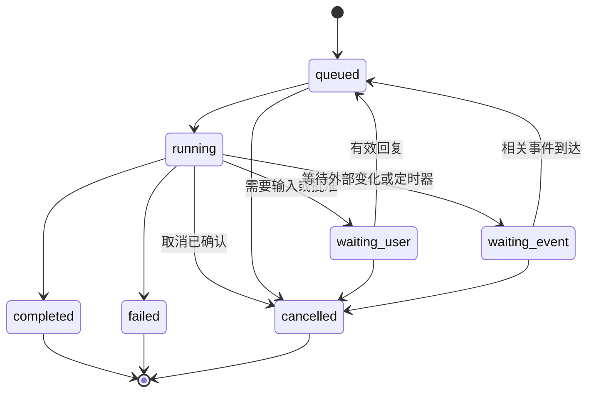

# 常驻 Agent 的架构与可靠执行

## 来源与适用范围

主要来源：[Building always-on agents](https://claude.com/resources/articles/building-always-on-agents)，William Hu，Anthropic，发布于 2026-11-13。

这是一篇面向工程实现的阅读笔记，适用于跨多次执行推进任务、响应外部事件、主动跟进或等待用户批准的 Agent。下文分别记录原文要点、工程延伸和待验证问题；其中的设计与验收场景均为建议，未在此记录实际运行结果。

## 原文核心观点

常驻 Agent 大部分时间处于休眠状态，由事件唤醒，完成工作、保存状态，再等待下一次触发。持续服务的体验依赖模型循环外围的五个组件。

| 组件 | 职责 |
| --- | --- |
| Event inbox | 持久化接收事件，去重、合并；同一 inbox 同时仅有一个活跃 worker。 |
| Timers | 保存一次性跟进和周期任务，到期后生成 inbox 事件。 |
| Memory | 保存指令、偏好、进度和已告知内容；能重新查询的信息优先存引用。 |
| Permissions | 对工具调用放行、拒绝或等待批准；保存会话后释放 worker，收到回复再恢复。 |
| Outbox | 管理结果投递、恢复和通知节奏；一次执行可以安静结束。 |

Run 是一次执行，Session 是可跨多次执行的消息与工具记录，Memory 负责跨会话连续性。必须保留的信息应及时写入持久存储，避免依赖可能被压缩的聊天历史。以上概括依据[原文](https://claude.com/resources/articles/building-always-on-agents)。

## 工程延伸：将连续性变成可恢复的状态

以下是基于原文架构的设计建议，不能视为原文已有的完整实现或经过验证的实践结论。

### 任务正式状态与语义记忆分开

用户偏好、经验摘要适合进入供模型参考的记忆。任务是否已完成、是否正在等待批准、外部动作是否成功，则应成为系统能够查询和校验的正式状态。

建议为长期任务维护以下信息：

| 信息 | 用途 |
| --- | --- |
| `task_id`、状态、状态版本 | 标识任务，约束状态迁移，避免旧执行覆盖新结果。 |
| 检查点、已完成步骤、外部操作结果 | 恢复时确认从哪里继续，以及哪些动作已经发生。 |
| `waiting_for`、下一步动作 | 区分等待用户、等待事件和可立即执行。 |
| 关联定时器、批准请求 | 完成、取消或变更任务时清理后续动作。 |

任务状态可以采用如下示意；实际项目应进一步定义每种状态允许的动作和转换条件。

### 将重复执行作为明确的故障场景

考虑一个假设场景：创建工单已经成功，但 worker 在保存成功结果前崩溃。恢复后重新调用创建接口，可能产生第二张工单。

输入事件去重不足以解决这种情况。对会产生外部影响的动作，建议分配稳定的 `action_id`，记录调用意图与结果，并在重试时复用外部 API 支持的幂等键。Stripe 的幂等接口说明了这种机制如何支持安全重试，但具体有效期与保证范围仍应以所接 API 的文档为准。[Stripe：Designing robust and predictable APIs with idempotency](https://stripe.com/blog/idempotency)

如果外部服务没有幂等或查询能力，应显式保留“结果未知”状态，先尝试核对或交由人工处理，避免将所有超时都当成失败后直接重试。这是针对上述故障场景的保守设计建议。

当任务状态和待发送消息位于同一个支持事务的数据库中，可以在同一事务内更新状态并写入 outbox，再异步投递。Transactional outbox 用于处理数据库更新与消息发送的双写一致性问题；转发仍可能重复，接收端需要相应的幂等处理。它不能单独保证任意外部动作只发生一次。[AWS：Transactional outbox pattern](https://docs.aws.amazon.com/prescriptive-guidance/latest/cloud-design-patterns/transactional-outbox.html)

### 用确定性代码落实运行边界

模型可以提出下一步操作、解释结果、判断是否需要询问。系统代码负责落实工具权限、租户隔离、事件领取、重试、预算、批准有效性和状态提交。

例如，模型提出发送邮件后，权限层应校验批准是否覆盖当前收件人、正文和附件。批准记录建议绑定到具体动作及参数版本；动作改变、授权过期或任务取消后，需要重新检查执行资格。

等待用户时保存必要状态并释放执行资源。收到迟到的批准或外部事件时，先检查任务当前状态，避免恢复已经取消或完成的操作。

### 为跟进和通知设置独立规则

主动运行与通知用户可以分别决策。一个监控 PR 的任务可能多次检查 CI、评审和冲突，但通常只在出现需要处理的变化、目标达成或执行受阻时通知。

建议同时定义任务总预算、最长持续时间、最大无进展次数，以及重复提醒的间隔。任务完成或取消后，应清理关联定时器；同一问题已通知或已处理时，应抑制后续重复提醒。

## 建议的实现顺序与验收场景

实现顺序可从持久化事件、任务状态与恢复开始，再加入外部动作幂等、等待与取消、定时跟进、通知控制，最后扩展记忆检索。这是便于优先验证可靠性的顺序，并非所有产品都必须采用的固定路线。

可以先用以下故障场景验收一个完整任务：

| 场景 | 预期行为 |
| --- | --- |
| 同一事件重复到达 | 不重复产生外部动作或用户通知。 |
| 外部动作成功后 worker 崩溃 | 恢复后核对或复用原操作结果。 |
| 工具调用超时、结果不明 | 进入核对流程，不盲目重复有副作用的操作。 |
| 等待批准期间重启 | 保留请求和任务状态，能够继续处理有效回复。 |
| 用户取消后定时器或批准到达 | 识别任务已取消，不继续原动作。 |
| 多次检查均无变化 | 保持安静，受预算与跟进策略约束。 |

这些是待执行的验收目标，本笔记不声称它们已经通过测试。

## 待验证问题

- 并发隔离应按用户、任务还是共享资源划分？不同任务访问同一资源时如何协调？
- 外部服务的幂等键有效期、查询能力和重试策略是否覆盖任务最长生命周期？
- 任务状态、记忆和 outbox 分处不同存储时，怎样提交与恢复？
- 怎样衡量有效进展、恢复成功率、重复动作率和无价值通知比例？
- 长期指令与记忆如何更新、撤销和淘汰，避免过期信息持续影响决策？

## 关联笔记

[持久运行与个人 Agent 的设计实现](../Agent/持久运行与个人%20Agent%20的设计实现.md)：多产品对照与综合设计建议。

[阅读索引](README.md) · [Agent 专题](../Agent/README.md)
